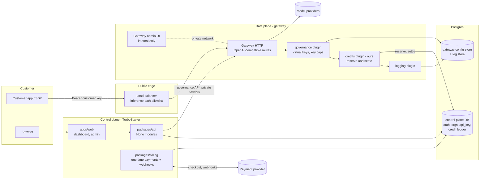

# Platform architecture

An OpenAI-compatible AI gateway in front of many model providers, sold with prepaid credits. Modeled on OpenRouter's public behavior (see `research/`).

Two codebases, one repository:

- **Control plane**: TurboStarter (this monorepo). Auth, organizations, billing, customer dashboard, admin.
- **Data plane**: Bifrost (Apache-2.0, Go), pinned to `transports/v2.6.0`, white-labeled, living in `apps/gateway/`. Proxies all model traffic.

Decisions are recorded in `adr/`. This page is the map.

## Components

## Request path (inference)

1. The customer calls `POST /v1/chat/completions` (or another supported route) with `Authorization: Bearer <customer key>`.
2. The edge forwards only allowlisted inference paths (ADR 0007).
3. Gateway auth resolves the key to a **virtual key**, which belongs to the **customer** whose id is the organization id (ADR 0004).
4. The **governance** plugin applies key rules: allowed providers and models, customer-set spend caps and rate limits.
5. The **credits** plugin estimates the request's maximum cost and atomically **reserves** it against the organization's balance. If the balance cannot cover it, the request ends with `402` before any provider call (ADR 0001).
6. The gateway calls the provider, with retries and fallbacks.
7. After the response (or the final stream chunk), the credits plugin **settles**: actual provider cost converted to SAR at the effective rate, with no markup (ADR 0010, 0017), written as one append-only ledger entry with an idempotency key, and the hold is released (ADR 0002).
8. The logging plugin records the request in the gateway log store. A daily job reconciles that log against the ledger.

## Money path (top-up)

1. A member buys a top-up in the dashboard. TurboStarter creates a one-time checkout with the payment provider (ADR 0003).
2. The provider's verified webhook appends a `top_up` ledger entry, keyed by the payment id, and raises `credit_account.balance` in the same transaction.
3. The next request sees the new balance.

## Data ownership

| Data                                             | Owner                                      | Store                                                          | Notes                                                                                                              |
| ------------------------------------------------ | ------------------------------------------ | -------------------------------------------------------------- | ------------------------------------------------------------------------------------------------------------------ |
| Users, sessions, organizations, members          | Control plane                              | control plane DB                                               | Better Auth                                                                                                        |
| Customer API keys (metadata, hash, prefix)       | Control plane                              | control plane DB (`api_key`)                                   | Plaintext shown once, never stored                                                                                 |
| Credit ledger, balances, reservations            | Control plane schema, written by both      | control plane DB                                               | Integer micro-USD, append-only. The gateway's DB role can only insert entries and update balances and reservations |
| Payments, orders                                 | Control plane                              | control plane DB + payment provider                            |                                                                                                                    |
| Virtual keys, customers, key caps, provider keys | Gateway, written only by the control plane | gateway config store                                           | Encrypted at rest with a config-store encryption key                                                               |
| Model catalog and provider prices                | Gateway                                    | gateway config store, synced from our own pricing file or host | Bifrost's default `getbifrost.ai` URL is replaced (Phase 4)                                                        |
| Request logs                                     | Gateway                                    | gateway log store                                              | Source for customer usage views and reconciliation                                                                 |

Both databases run on one Postgres server at launch, as two databases.

## Money rules

- The unit is micro-USD (`bigint`, 1 USD = 1,000,000). Provider prices stay in the catalog's own precision. Only per-request totals are rounded, once, half up.
- The ledger is append-only. Balances are a cache rebuilt from it.
- Every write that moves money carries an idempotency key with a unique constraint: payment id, refund id, or the request attempt tuple.
- The balance can go slightly negative when a request's actual cost exceeds its reservation. The next request is then refused until a top-up.

## Deployment shape at launch

- One gateway instance plus a standby (ADR 0006). More instances only after the cross-instance invalidation patch passes its test.
- Control plane: TurboStarter's normal deployment (Next.js web app plus the Hono API).
- Postgres: one server, two databases.

## Owner decisions still open

| Decision                                                         | Where it matters |
| ---------------------------------------------------------------- | ---------------- |
| Brand inputs (name, domain, code name, prefixes, Go module path) | Phase 5 rename   |
| Payment provider                                                 | ADR 0003         |
| Purchase fee (value set by staff, ADR 0010), top-up amounts      | ADR 0003         |
| Charging for failed attempts that consumed tokens                | ADR 0002         |

## ADR index

| #                                            | Decision                                                                                 |
| -------------------------------------------- | ---------------------------------------------------------------------------------------- |
| [0001](adr/0001-credits-ledger.md)           | Credits ledger in Postgres, enforced by a gateway plugin with reservations               |
| [0002](adr/0002-usage-path.md)               | Usage reaches the ledger through a gateway plugin, with log reconciliation as a backstop |
| [0003](adr/0003-billing.md)                  | Prepaid top-ups through one-time payments                                                |
| [0004](adr/0004-key-model.md)                | One organization is one gateway customer, one dashboard key is one virtual key           |
| [0005](adr/0005-margin.md)                   | Margin applied in the ledger plugin (superseded: no markup, ADR 0010 amended)            |
| [0006](adr/0006-scaling.md)                  | One gateway instance at launch; more only after a tested invalidation patch              |
| [0007](adr/0007-gateway-admin-ui.md)         | Gateway admin UI is internal only                                                        |
| [0008](adr/0008-upstream-upgrades.md)        | Take each upstream minor release within two weeks, by script                             |
| [0009](adr/0009-credits-plugin-hooks.md)     | The credits plugin reserves and settles per attempt, and fails closed                    |
| [0010](adr/0010-admin-controlled-pricing.md) | The top-up fee is set by staff in the admin console; no markup on requests (amended)     |
| [0011](adr/0011-staff-roles.md)              | Staff roles (admin, finance, support) and how the admin console is protected             |
