# OpenRouter — Organization account and one free request

Companion to `openrouter-flows.md` (Individual account) and `openrouter-org-flows.md` (first look at the org). Captured 27 Nov 2026, 01:30–01:40 GMT+3. The account was already an **Organization** (Standard plan) with one admin member and one pending invitation.

**How this was captured**

- **Part A was read-only.** The invite, create-workspace, organization-manage and account-security dialogs were opened, then cancelled or closed. Nobody was invited, no role was changed, nothing was bought, no key was created, and no account or org setting was saved.
- **Part B sent exactly one message,** "Hello", to **Nemotron 3.5 Lightning (free)**. Before sending, the chat's server tools (web search, image generation, advisor, etc.) were switched **off for that composer only**, so nothing paid could run. The result: cost $0.00. A chat room named "Hello" now exists in the workspace.
- **Masking:**
  - Done in the page before each capture: name, email, org name (`[org]`), org/user/workspace IDs, generation/request/session IDs, IP address, and location.
  - Done afterwards in the images: avatar initials, the key's last characters, and the device location line.
  - Balances are masked (`$•••`). The $0.00 spend after the free request is left visible because it's the point of Part B.
- Each image is one viewport (1084×689). Taller images are stitched from scrolled frames, with grey dividers between frames. Image 32 adds horizontally scrolled strips of the same log row so every column is visible.

---

# Part A — Organization account

## A0. Switching into the org

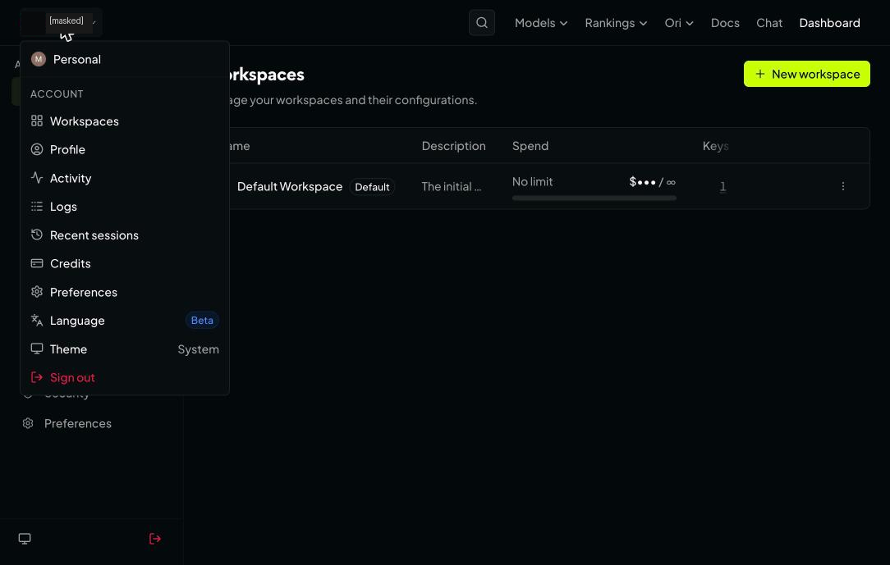

**Where:** header account chip.

- **Purpose:** switch between the Personal account and each organization the user belongs to.
- **Layout:** the chip shows the org logo and name. The menu lists "Personal" first, then: ACCOUNT → Workspaces, Profile, Activity, Logs, Recent sessions, Credits, Preferences, Language (Beta), Theme (System), Sign out.
- **Main action:** choosing another account reloads the whole app in that context. Credits, workspaces, keys, logs and policies all change.
- **Org-only sidebar entries:** **Members** in the account sidebar, and an org **Management keys** scope. Details in A5.

---

## A1. Members, roles, invitations

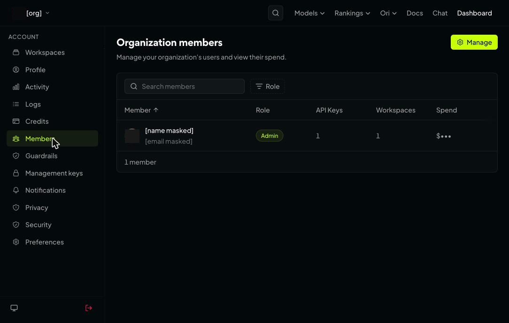

**URL / purpose:** `/settings/organization-members` — "Manage your organization's users and view their spend."

- **Layout:** title + **Manage** button → toolbar → members table → count footer.
- **Controls:** search members; **Role** filter (All / Admin / Member); sortable column headers.
- **Columns:**
  - **Member:** avatar, name, email.
  - **Role:** badge.
  - **API Keys:** count of keys the member owns.
  - **Workspaces:** count.
  - **Spend:** USD. Hovering shows the split "Credits $x · BYOK $y".
  - Footer: "1 member".
- Clicking a member opens their profile (A6c).

### Manage organization dialog

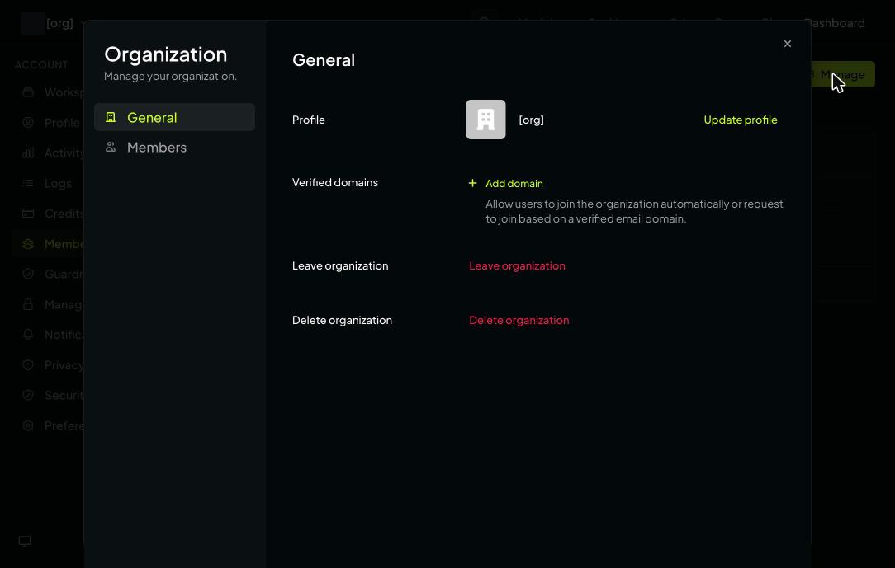 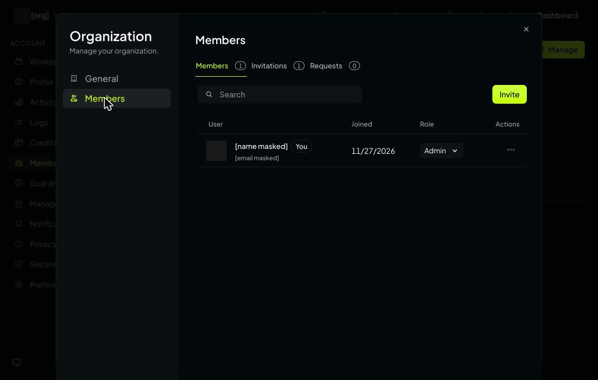

- **General tab:**
  - Profile (logo + name, "Update profile").
  - **Verified domains** (+ Add domain: "Allow users to join the organization automatically or request to join based on a verified email domain").
  - **Leave organization** and **Delete organization** (red).
- **Members tab:** sub-tabs **Members (1) · Invitations (1) · Requests (0)**.
  - Members table: User ("You" tag), Joined (date), **Role** (inline dropdown), Actions (⋯).
  - Footer: **"2 of 20 seats used"**. Pending invitations count as seats.

### Invite dialog (opened, not sent)

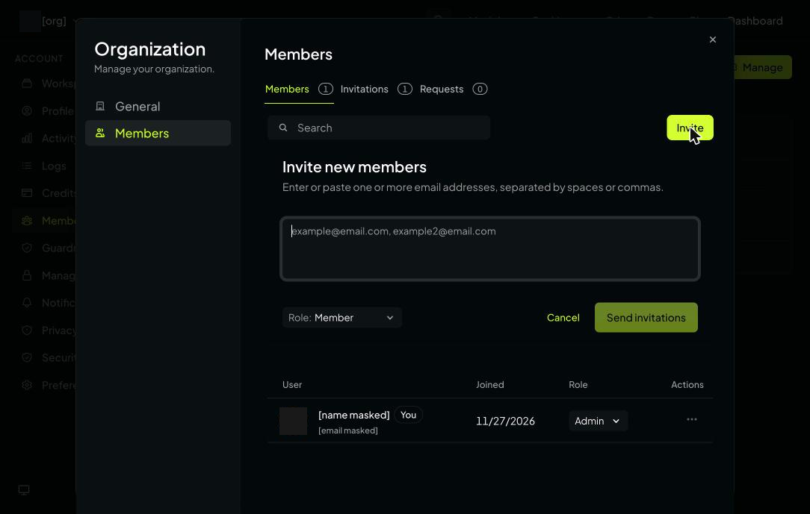

- Inline panel "Invite new members — Enter or paste one or more email addresses, separated by spaces or commas."
- Multi-email textarea, **Role** select (**Member** / **Admin**), **Cancel**, **Send invitations**.
- **Main action (not performed):** sends one email per address. Each appears under Invitations with its role until accepted.

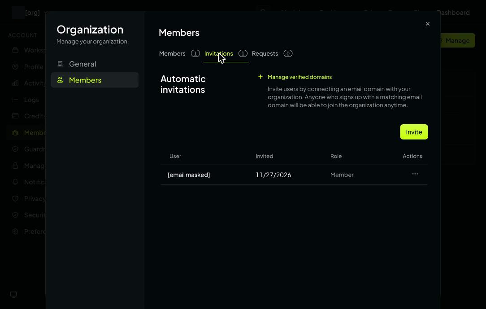

- **Invitations tab:**
  - "Automatic invitations — Manage verified domains" ("Anyone who signs up with a matching email domain will be able to join the organization anytime").
  - **Invite** button, and a table **User (email) · Invited · Role · Actions** (⋯ revoke).
- **Requests tab:** join requests from verified-domain users, for an admin to approve or reject.

### Role permissions

The UI has only two roles. The member-facing details below come from OpenRouter's organization docs ([organization management](https://openrouter.ai/docs/use-cases/organization-management)):

| Capability                                           | Admin              | Member                     |
| ---------------------------------------------------- | ------------------ | -------------------------- |
| Use the org credit pool / org resources              | ✓                  | ✓                          |
| Create API keys                                      | ✓                  | ✓                          |
| See and manage keys                                  | all keys           | **only keys they created** |
| View activity                                        | all                | **own activity**           |
| Add / remove members, change roles                   | ✓                  | —                          |
| Billing setup (payment methods, invoicing, contacts) | ✓                  | —                          |
| Org settings, notifications, management keys         | ✓ (UI shows these) | —                          |

The API uses role values `org:admin` / `org:member`. Workspaces also have their own `admin` / `member` role values in the SDK, but the UI didn't expose per-workspace roles.

---

## A2. Organization credits and billing

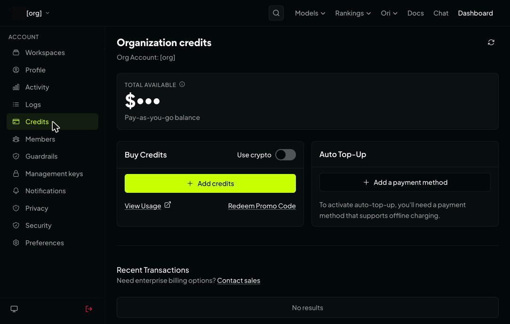

**URL:** `/settings/credits` while in org context — **"Organization credits"**, subtitle "Org Account: [org]".

- **Balance:** "TOTAL AVAILABLE $•••, Pay-as-you-go balance". This is the org's own pool, separate from the personal balance.
- **Buy Credits card:** Use crypto toggle, **Add credits**, View Usage ↗, Redeem Promo Code. Add credits leads to the same billing-address gate documented in the Individual doc. Not opened again.
- **Auto Top-Up card:** "Add a payment method" (must support off-session charging).
- **Invoices / receipts:** Recent Transactions table **Date · Amount · Actions**. The Actions column holds the per-purchase receipt/invoice. Empty here ("No results · 0 transactions"). "Need enterprise billing options? Contact sales."
- **Payment methods** (pricing FAQ): cards, AliPay and crypto (USDC) on Standard/Business. Enterprise gets invoicing and purchase orders. Prices exclude tax; VAT/GST is added on invoices where required.
- **Who can pay:** billing configuration is an **Admin** capability (see A1). Members spend from the pool through their keys. The personal account's Credits page offers **"Move credits to organization"**, gated by 2FA, so a member can fund the org from personal credit.
- **Plan / fee** (Preferences, A3): "Account Type — Tier: Standard — Top-up platform fee 5.5%", with a Manage button to upgrade.

---

## A3. Organization settings, security, policies, audit

### Preferences (org identity and plan)

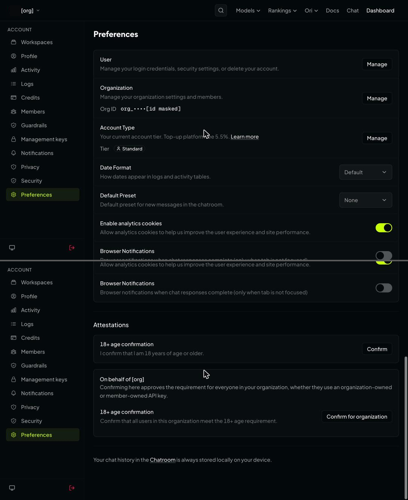

- **User:** Manage (personal login, security, delete account; see below).
- **Organization:** "Manage your organization settings and members", **Org ID** (copyable, masked), Manage (opens the dialog in A1).
- **Account Type:** Tier "Standard", top-up fee 5.5%, Manage (upgrade).
- Date format, Default preset (for chat), analytics cookies, browser notifications.
- **Attestations:**
  - Personal "18+ age confirmation".
  - **"On behalf of [org]"** confirmation, which approves the requirement "for everyone in your organization, whether they use an organization-owned or member-owned API key".
- Footer: "Your chat history in the Chatroom is always stored locally on your device."

### 2FA / SSO

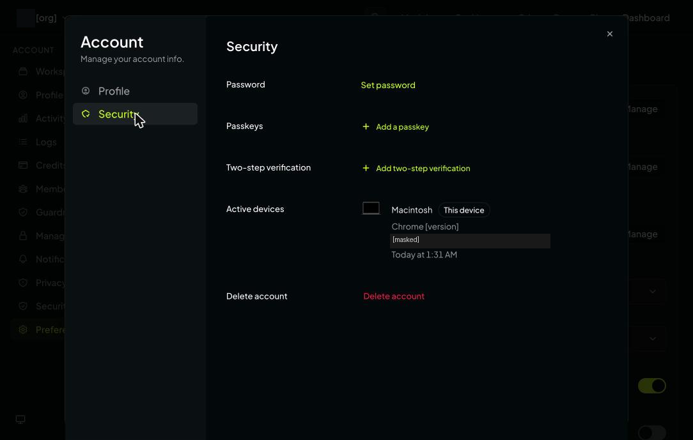

- 2FA is **per user**: User → Manage → Security has Set password, **Add a passkey**, **Add two-step verification**, Active devices (device, browser, IP and location masked, last seen), Delete account.
- **No org-wide "require 2FA" switch was visible.** 2FA is only enforced as a gate for actions like moving credits.
- **SSO (SAML) and SCIM** are Enterprise-only, enabled through sales (pricing FAQ). Business/Enterprise also get **Workload Identity Federation** (services authenticate with tokens from your own identity provider instead of long-lived keys). No SSO settings page appears on Standard.

### Security (key hygiene)

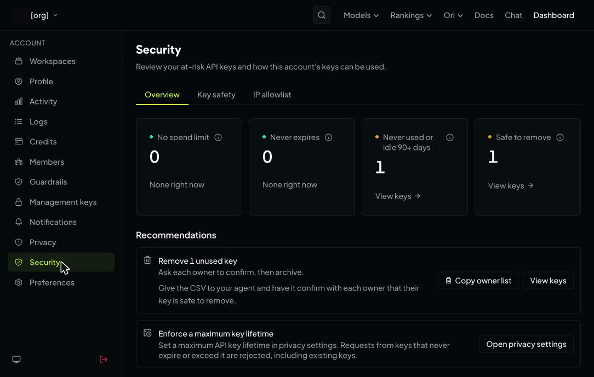 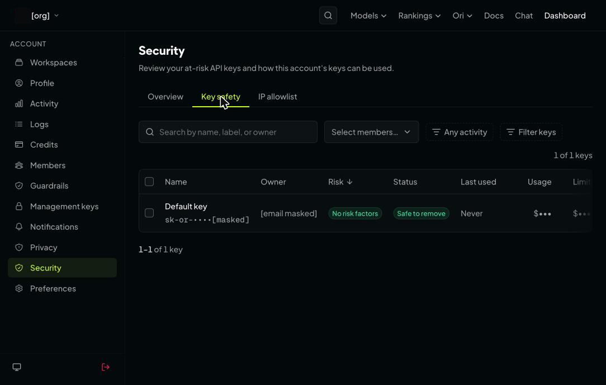 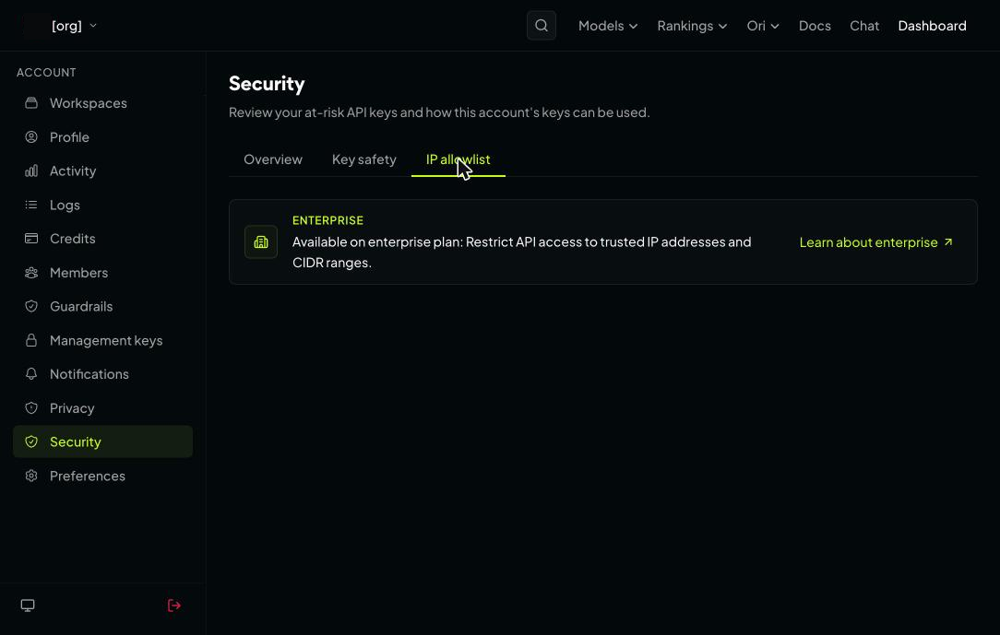

**URL:** `/settings/security` — "Review your at-risk API keys and how this account's keys can be used." Tabs:

- **Overview:**
  - Risk tiles with tooltips and drill-down "View keys": **No spend limit** ("A leaked key could spend without a cap"), **Never expires**, **Never used or idle 90+ days**, **Safe to remove**.
  - **Recommendations:** "Remove 1 unused key — Ask each owner to confirm, then archive", with **Copy owner list** (CSV "for your agent") and View keys. "Enforce a maximum key lifetime" with a link to Privacy settings.
- **Key safety:**
  - Org-wide key inventory. Search (name, label or owner), **Select members…**, activity filter, risk filter.
  - Table: Name + masked key · **Owner** · **Risk** ("No risk factors") · **Status** ("Safe to remove") · Last used · Usage · Limit · Expires. Row checkboxes for bulk actions.
- **IP allowlist:** Enterprise upsell: "Restrict API access to trusted IP addresses and CIDR ranges."

### Policies

- **Guardrails (account level):** 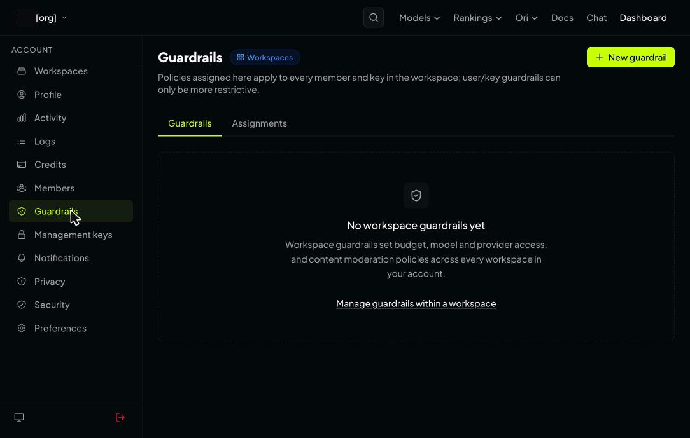
  - "Policies assigned here apply to every member and key in the workspace; user/key guardrails can only be more restrictive." Tabs Guardrails / Assignments, plus **New guardrail** (not opened).
  - Empty state: "Workspace guardrails set budget, model and provider access, and content moderation policies across every workspace in your account."
  - Policy layers are Account settings → Workspace → Member (see A6c), and each layer can only narrow the one above.
- **Privacy:** same page as Individual (ZDR, data-training toggles, max key lifetime, provider/author allow-lists), applied to the whole org.
- **Notifications:** 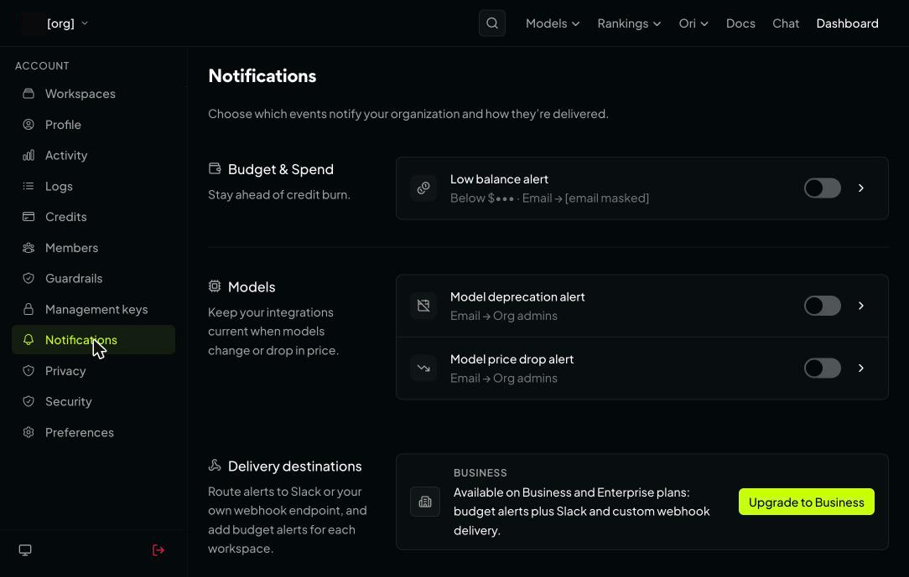
  - "Choose which events notify your organization and how they're delivered."
  - **Low balance alert** (below $X → email), **Model deprecation alert** (→ Org admins), **Model price drop alert** (→ Org admins).
  - **Delivery destinations** (Slack, custom webhook, per-workspace budget alerts) are a **Business** upsell.
- **Management keys (org scope):** "Automate admin work across your organization, like creating API keys and managing members and budgets, with keys that can't make model requests." Filters: Scope, Status (Active). Empty state: "No matching management keys".

### Audit log

**No audit-log page exists** on this Standard org; none was found in either sidebar, the org dialog, Security or Preferences. Audit-style information is spread across other places:

- "Created … by [member]" on workspaces.
- Key owner, last-used and expiry in Security → Key safety.
- Active devices per user.
- Per-request **Org Member** attribution in Logs (Part B).

---

## A4. Workspaces under the org: member and key assignment

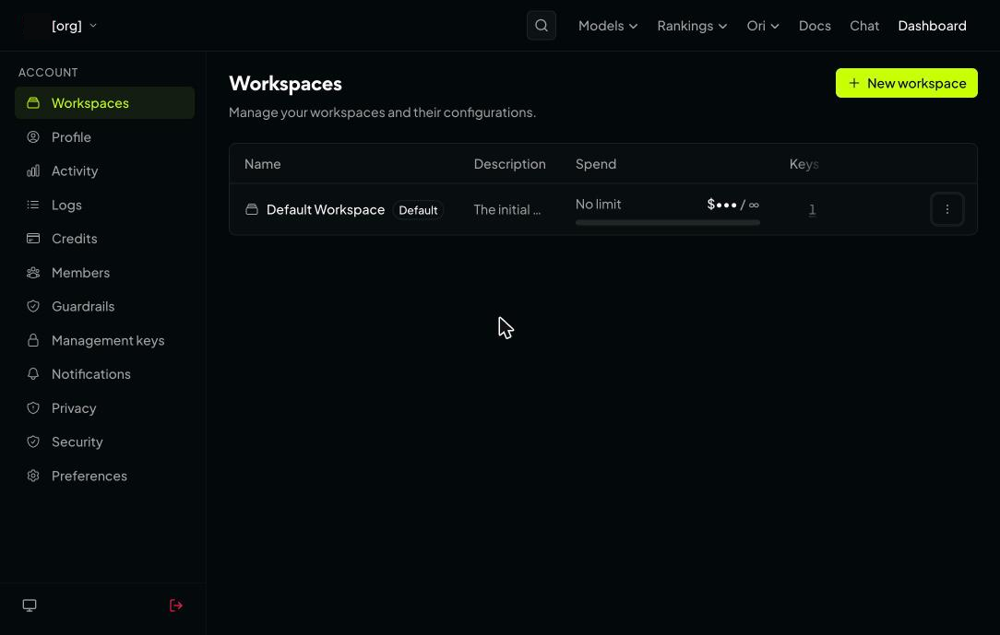 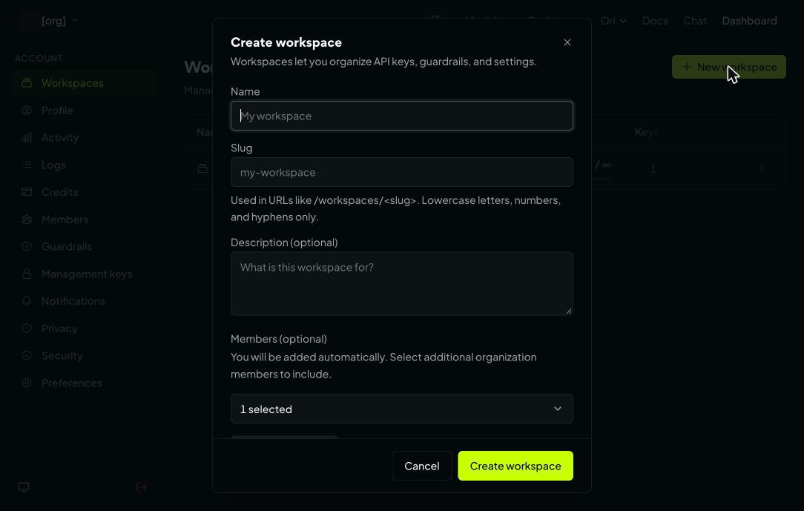 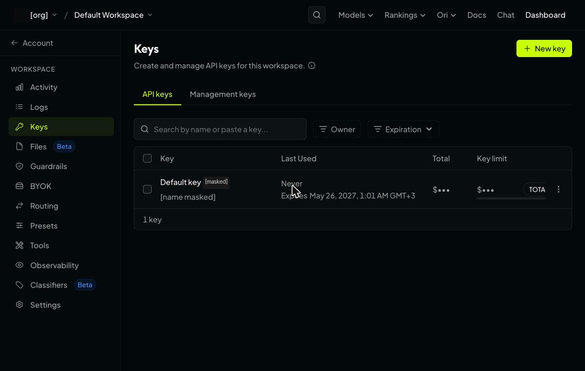

- **Workspaces list:** Name · Description · Spend (limit bar "$x / ∞") · Keys · **Members** · Actions (⋯ → **Edit workspace**, which opens that workspace's Settings, or **View activity**).
- **Default Workspace:** "The initial workspace that **all org members are a part of by default**."
- **Create workspace dialog (cancelled):**
  - Name; **Slug** (URL `/workspaces/<slug>`); Description.
  - **Members (optional):** "You will be added automatically. Select additional organization members to include." Multi-select listing org members.
  - **BYOK-only routing** toggle.
  - **Budgets (optional):** credit limit $ with reset (Daily…), plus "Include BYOK spend".
  - Cancel / Create workspace.
  - So workspace membership is set at creation. Workspace Settings has no separate members section.
- **How keys are assigned:**
  - Keys are created **inside a workspace** (Workspace → Keys) and are **owned by the member** who created them.
  - The Keys page has **Owner** and **Expiration** (All/Active/Expired) filters and row checkboxes. Each row shows the owner's name. Row menu: **Activity · Edit · Disable · Delete**.
  - Key limits count credits only ("BYOK does not").
  - Members see only their own keys (docs). Admins see all keys, and so does Security → Key safety.
- **Per-workspace management keys:** Workspace → Keys → "Management keys" tab: "Automate admin work in this workspace, like creating and rotating API keys".

---

## A5. Pages that exist only for organizations

| Page / element                                             | Where                                        | What it adds                                                                                 |
| ---------------------------------------------------------- | -------------------------------------------- | -------------------------------------------------------------------------------------------- |
| **Members** page                                           | Account sidebar                              | Members table with role, key count, workspace count, spend split credits/BYOK                |
| **Manage organization** dialog                             | Members → Manage, Preferences → Organization | Org profile, verified domains, members, invitations, join requests, seats (20), leave/delete |
| **Organization credits**                                   | Credits                                      | Separate org wallet                                                                          |
| **Org-scope Management keys**                              | Account sidebar                              | Admin automation across the org (members, budgets, keys)                                     |
| **"On behalf of [org]" attestation**                       | Preferences                                  | One admin confirms 18+ for the whole org                                                     |
| **Org ID**                                                 | Preferences                                  | Identifier for API/admin use                                                                 |
| **Member profile page**                                    | Members → click member, or Profile           | Per-member usage, keys, workspaces, model access by policy layer (A6c)                       |
| **Top Users** card, **User** filter, **Org Member** column | Activity, Logs                               | Per-member attribution (Part B)                                                              |
| **Workspace Members** column + member picker               | Workspaces                                   | Workspace membership                                                                         |
| **Notifications → "Org admins"** recipients                | Notifications                                | Role-based alert routing                                                                     |

### Member profile

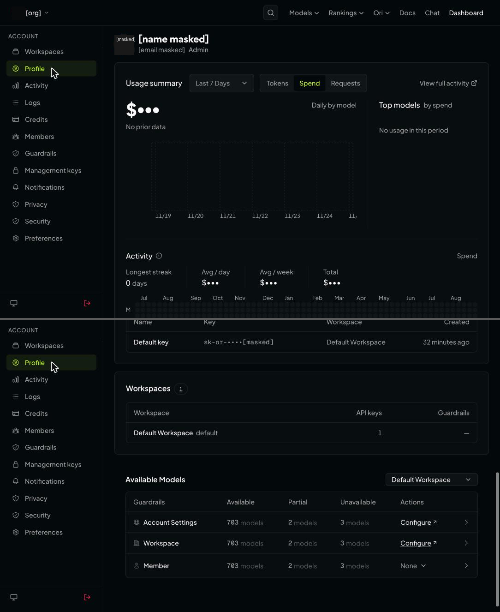

- Header: avatar, name, email, role.
- **Usage summary:** range (Last 7 Days), metric toggle Tokens / **Spend** / Requests, a daily-by-model chart, "Top models by spend", View full activity ↗.
- **Activity:** longest streak, avg/day, avg/week, total, and a year-long contribution heatmap (Less → More).
- **API keys:** active vs disabled/expired counts, last created, plus a table Name · Key (masked) · Workspace · Created.
- **Workspaces:** table Workspace · API keys · Guardrails.
- **Available Models** (workspace selector): Guardrail layer · Available · Partial · Unavailable · Actions. Rows: **Account Settings** (703 / 2 / 3 models, Configure ↗), **Workspace** (Configure ↗), **Member** (per-member guardrail dropdown, "None"). This shows the effective model access after each policy layer.

---

# Part B — One free request

## B1. Sending it

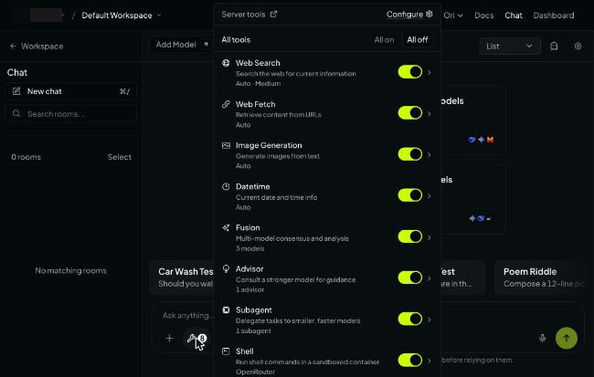 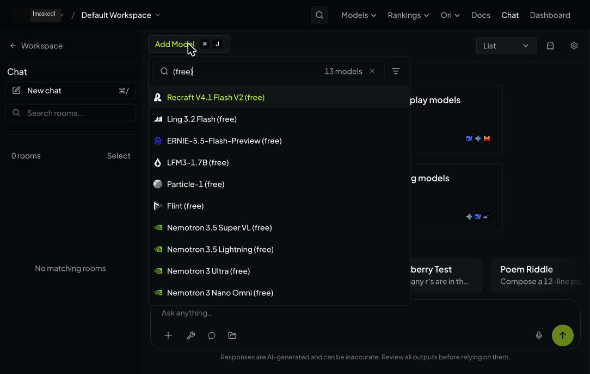 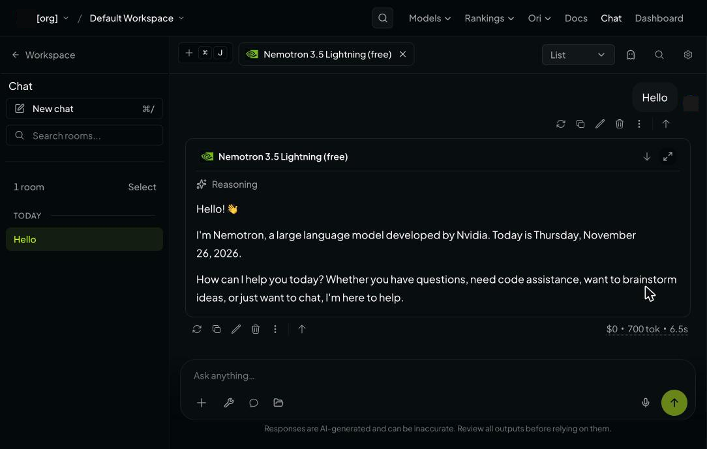 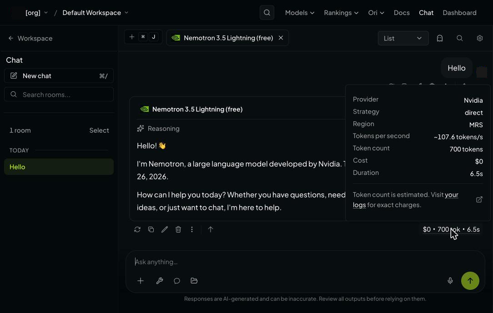

1. **Tools menu (composer wrench, badge "8 active"):** "Server tools" with Configure, All on / All off, and per-tool toggles. Each tool has a mode:
   - Web Search (Auto · Medium), Web Fetch, Image Generation, Datetime.
   - **Fusion** (multi-model consensus, 3 models), **Advisor** (consult a stronger model), **Subagent**, **Shell** (sandboxed container).
   - **All off** was used, so the badge reads 0 active. These tools can add paid calls even on a free model.
2. **Add Model → search "(free)"** → "13 models", all suffixed "(free)". Picked **Nemotron 3.5 Lightning (free)**.
3. Typed "Hello" and pressed Enter. A room "Hello" appeared under TODAY in the rail.
4. **Response card:** model name, collapsible **Reasoning** section, the answer, then action icons (regenerate, copy, edit, delete, more, scroll to top) and an inline metrics chip **"$0 · 700 tok · 6.5s"**.
5. **Metrics tooltip:** Provider Nvidia · Strategy **direct** · Region **MRS** · Tokens per second ~107.6 · Token count 700 · Cost $0 · Duration 6.5s · "Token count is estimated. Visit your logs for exact charges."

## B2. Logs: the new row, every column

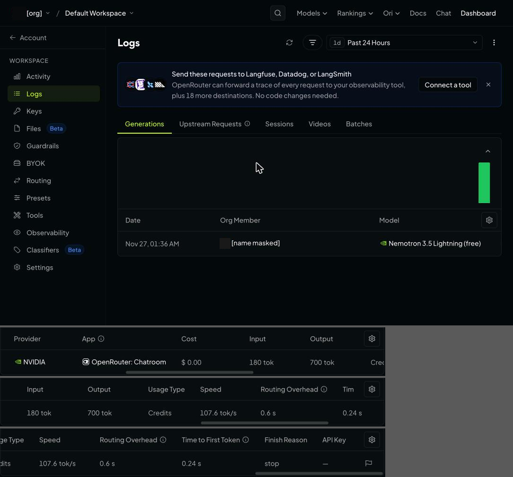

**URL:** Workspace → Logs → **Generations**. New since the empty state:

- A request-volume histogram above the table (collapsible ⌃).
- A dismissible banner: "Send these requests to Langfuse, Datadog, or LangSmith… plus 18 more destinations. No code changes needed. [Connect a tool]".

| Column                  | Value                         | Notes                                                |
| ----------------------- | ----------------------------- | ---------------------------------------------------- |
| Date                    | Nov 27, 01:36 AM              | local timezone (GMT+3)                               |
| **Org Member**          | [name]                        | org-only column                                      |
| Model                   | Nemotron 3.5 Lightning (free) |                                                      |
| Provider                | NVIDIA                        | serving provider                                     |
| App                     | OpenRouter: Chatroom          | from referer/app attribution (ⓘ)                     |
| Cost                    | $ 0.00                        |                                                      |
| Input                   | 180 tok                       | native prompt tokens                                 |
| Output                  | 700 tok                       | native completion tokens, **includes 629 reasoning** |
| Usage Type              | Credits                       | vs BYOK                                              |
| Speed                   | 107.6 tok/s                   |                                                      |
| Routing Overhead (ⓘ)    | 0.6 s                         | router decision time                                 |
| Time to First Token (ⓘ) | 0.24 s                        |                                                      |
| Finish Reason           | stop                          |                                                      |
| API Key                 | —                             | chat uses no API key                                 |
| (row action)            | ⚑                             | flag / feedback                                      |

Optional columns from the gear menu: BYOK Usage, Cache Usage.

## B3. Request detail (click the row)

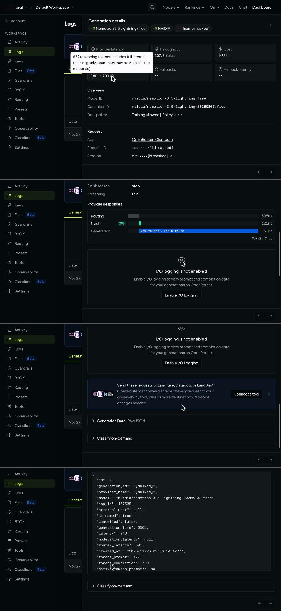

**"Generation details"** side panel. Header chips: model · provider · member. ‹ › arrows step through rows.

- **Tiles:**
  - **Provider latency 121 ms** · **Throughput 107.6 tok/s** · **Cost $0.00**.
  - **Tokens 180 → 700**, with tooltip "629 reasoning tokens (includes full internal thinking; only a summary may be visible in the response)".
  - **Fallbacks --** · **Fallback latency --**.
- **Overview:**
  - Model ID `nvidia/nemotron-3.5-lightning:free`.
  - **Canonical ID** `nvidia/nemotron-3.5-lightning-20260807:free` (dated permaslug).
  - **Data policy** "Training allowed | Policy ↗" (ⓘ). Free endpoints may train on prompts, which the account's privacy toggle allows.
- **Request:** App (link), **Request ID** `req-…`, **Session** `orc-…` ↗, **Generation ID** `gen-…`, **Finish reason** stop, **Streaming** true.
- **Provider Responses** (waterfall timeline): **Routing 596 ms** · **Nvidia [200] 121 ms** · **Generation: 700 tokens · 107.6 tok/s, 6.5 s** · **Total 7.1 s**.
- **I/O logging is not enabled:** "Enable I/O logging to view prompt and completion data for your generations on OpenRouter." [Enable I/O Logging] (not clicked). Prompt and completion text are not stored by default.
- Observability banner again.
- **Generation Data — Raw JSON** (expanded; IDs masked). Fields:
  - **Identity:** `generation_id`, `request_id`, `session_id`, `parent_generation_id`, `spawned_by`, `workspace_id`, `creator_user_id`, `api_key_id` (null for chat), `app_id` + `app{title, main_url…}`, `external_user`, `user_agent`, `http_referer`, `origin`.
  - **Routing:** `model` (canonical), `provider_name`, `router` (null), `preset_id`, `service_tier`, `data_region: "global"`, `api_type: "completions"`, `generation_type: "inference"`, `is_shadow`.
  - **Timing (ms):** `router_latency` 596, `latency` 243 (time to first token), `generation_time` 6505, `moderation_latency`.
  - **Tokens:**
    - Normalized: `tokens_prompt` 177, `tokens_completion` 739.
    - **Native (provider tokenizer, used for billing):** `native_tokens_prompt` 180, `native_tokens_completion` 700, `native_tokens_reasoning` 629, `native_tokens_cached` 0, `native_tokens_completion_images`.
    - Media and tool counts: `num_media_prompt`, `num_input_audio_prompt`, `num_media_completion`, `num_search_results`, `num_fetches`.
  - **Money (USD):** `usage` 0 (charged), `usage_upstream` 0 (provider cost), `usage_cache`, `usage_data`, `usage_web`, `usage_web_fetch`, `usage_upstream_web_fetch`, `usage_file`, `byok_usage_inference` 0, `is_byok` false.
    - Credit pools: `credit_pool_id`, `credit_pool_expires_at`, `credit_pool_usage` (all null).
  - **Outcome:** `streamed` true, `cancelled` false, `finish_reason` / `native_finish_reason` "stop", `content_guardrail_invoked` false, `web_search_engine`, `response_cache_source_id`, `tool_name`.
  - **Attempts:** `provider_responses[]`, one item `{endpoint_id, id, is_byok:false, latency:121, model_permaslug, provider_name, status:200}`.
- **Classify on-demand** (collapsed; not opened, since it may run a classifier).

**How this request was charged:** list price for a `:free` endpoint is $0/M input and output, so 180 native prompt tokens × $0 + 700 native completion tokens (629 of them reasoning) × $0 = **$0** (`usage` 0, `usage_upstream` 0). No tools ran, there was no BYOK, and no fallback attempt. The UI's "700 tok" is the native completion count. The JSON also keeps a normalized count (177/739) for cross-model comparison.

## B4. Upstream Requests tab

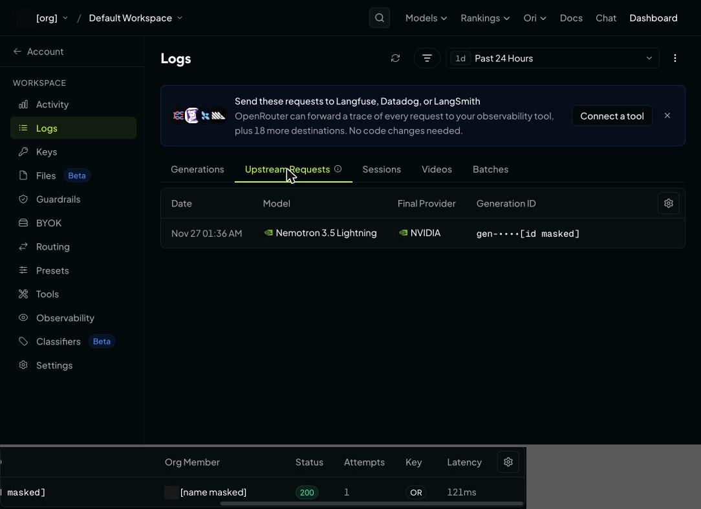 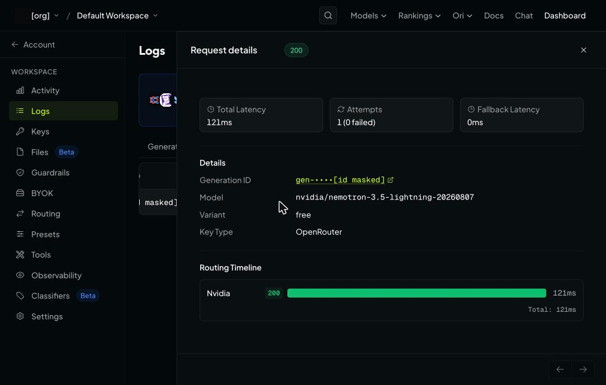

**Logs → Upstream Requests**: one row per provider attempt, so failed fallbacks show up here.

- **Columns:** Date · Model · **Final Provider** · **Generation ID** · Org Member · **Status** (200 badge) · **Attempts** (1) · **Key** ("OR" = OpenRouter key vs BYOK) · **Latency** (121 ms).
- **Request details panel (click row):**
  - Status 200. Tiles **Total Latency 121 ms** · **Attempts "1 (0 failed)"** · **Fallback Latency 0 ms**.
  - Details: Generation ID (links to the generation), Model `…-20260807`, **Variant** free, **Key Type** OpenRouter.
  - **Routing Timeline:** one bar per attempt, "Nvidia [200] 121 ms, Total 121 ms". Failed attempts would appear as extra bars with their error status.

## B5. Activity after the request

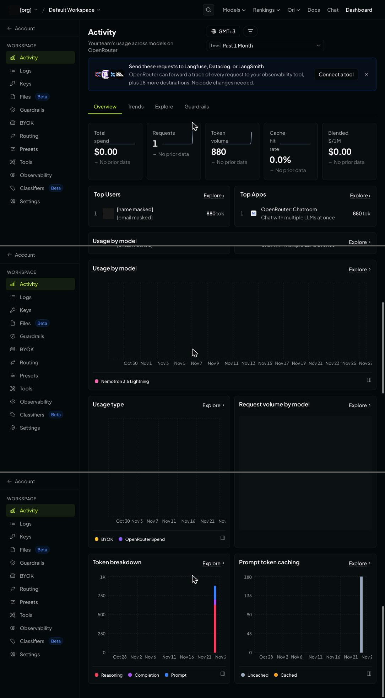

- **Tiles** ("No prior data" deltas because the window had nothing before):
  - **Total spend $0.00**, **Requests 1**, **Token volume 880** (= 180 in + 700 out).
  - **Cache hit rate 0.0%**, **Blended $/1M $0.00**. Sparklines step up at the right edge.
- **Top Users:** #1 [member] 880 tok. **Top Apps:** #1 OpenRouter: Chatroom ("Chat with multiple LLMs at once") 880 tok.
- **Usage by model:** legend Nemotron 3.5 Lightning. The spend chart stays flat because the cost was $0.
- **Usage type:** BYOK vs OpenRouter Spend, both 0.
- **Token breakdown:** one stacked bar on Nov 27 of about 880, mostly **Reasoning** (629), then Completion (71) and Prompt (180).
- **Prompt token caching:** one bar of 180, all **Uncached**.
- The banner "Send these requests to Langfuse, Datadog, or LangSmith" now also appears on Activity.

---

## What a gateway needs to copy (from this pass)

- [ ] Context switcher between personal and multiple orgs. Org-scoped wallet, workspaces, keys, policies and logs.
- [ ] Two roles (admin/member) with these rules: members create keys and see only their own keys and activity; admins manage members, billing and settings. Inline role change, invitations by pasted email list with role, revoke, verified-domain auto-join, join requests, a seat cap that counts pending invites.
- [ ] Per-member views: spend (credits vs BYOK), key and workspace counts, usage chart, activity heatmap, effective model access per policy layer (account → workspace → member, each only narrowing).
- [ ] Key hygiene center: risk tiles (no limit, never expires, idle 90+ days, safe to remove), org-wide key inventory with owner/risk/status, recommendations, owner-list CSV export, max-lifetime policy. Enterprise IP allowlist.
- [ ] Org notifications: low balance, model deprecation, price drops, routed to admins. Slack/webhook destinations as a higher tier.
- [ ] Org-scope and workspace-scope management keys that can't call models.
- [ ] Org-wide attestations (e.g., age confirmation) confirmed by one admin.
- [ ] Workspace creation with slug, member picker (creator added automatically), BYOK-only mode, budgets.
- [ ] Per-user 2FA/passkeys/devices. SSO (SAML) + SCIM + workload identity federation for higher tiers. **An audit log, which OpenRouter's Standard org lacks and a gateway should add.**
- [ ] Chat composer with per-room server-tool toggles (with an all-off switch) and inline per-message metrics: provider, routing strategy, region, tok/s, tokens, cost, duration.
- [ ] Generation record with request ID, session ID and generation ID; canonical dated model ID; data-policy flag; router / time-to-first-token / generation timings; both native and normalized token counts including reasoning and cached; charged vs upstream cost plus per-feature cost fields (web, fetch, file, cache, data); BYOK flag; credit-pool fields; one provider-attempt record per attempt.
- [ ] Upstream-attempt log: final provider, attempts (failed count), key type (gateway vs BYOK), per-attempt status and latency on a routing timeline.
- [ ] Prompt/completion bodies off by default (opt-in I/O logging). One-click export of traces to observability tools.
- [ ] Activity that updates immediately: token breakdown by reasoning/completion/prompt, cached vs uncached, top users, top apps.

Sources: [OpenRouter organization management docs](https://openrouter.ai/docs/use-cases/organization-management) (role permissions) · OpenRouter Pricing page FAQ (SSO/SCIM, payment methods, taxes).
