# OpenRouter: personal account, round 2 (onboarding, billing rules, notifications, workspace tools, compare, API errors, key lifecycle)

Companion to `openrouter-flows.md`, `openrouter-org-flows.md` and `openrouter-flows-org.md`. Captured 27 Nov 2026, 01:53–02:07 GMT+3, in the **Personal** account. I switched to it from the org with the account switcher (Standard plan, $0 balance).

**How this was captured**

- **Part C was read-only.**
  - The Create-workspace dialog was cancelled.
  - The New-preset form was left without clicking **Save Preset**.
  - The BYOK "add key" form was left via ← back without **Save**. Anthropic still shows "Not configured".
  - Notification panels were opened and closed without toggling anything.
  - The Add-credits flow stopped at the billing-address gate. No address, card or amount was entered.
- **Part D was the one approved write.**
  - Created the API key **capture-test** ($1 credit limit, 1-hour expiry).
  - Captured the copy-key dialog, its list row, its row menu, its edit page and the Disable confirmation. I clicked **Cancel** on Disable, since the key was being deleted next.
  - Then **deleted** it. The key list is empty again.
- **Masking:**
  - In the page before capture: emails, names, org name, IDs, the key secret, and the key detail page's key prefix/suffix.
  - In the images afterwards: the key's visible last characters, the billing "Full name" field, and avatar initials.
  - Balances show as `$•••`. The $0.00 spend on the throwaway key is left visible.
- Each image is one viewport (1084×689) unless stitched; stitched frames are separated by grey dividers. Image 42 is at 0.6 scale.

---

# Part C: Personal account (read-only)

## 1. Onboarding wizard (Individual vs Organization)

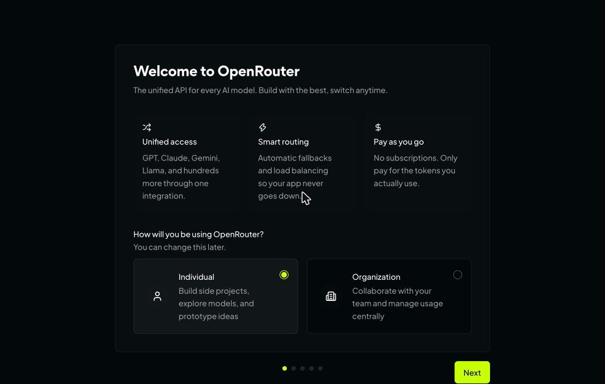 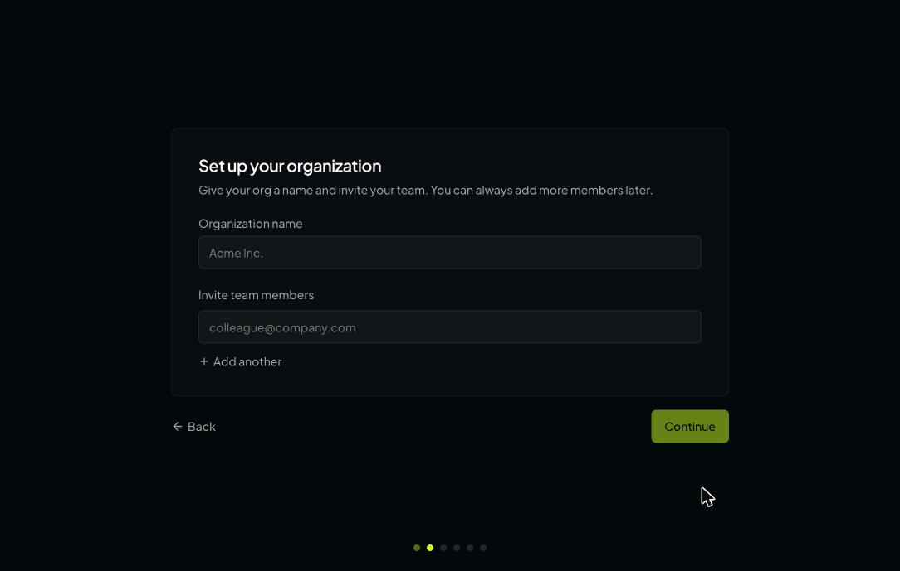 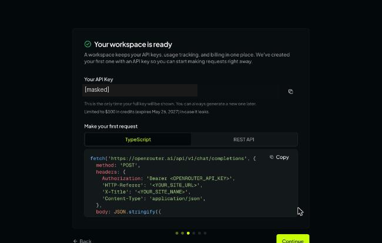

**Why these images come from earlier in the session:** the wizard can't be shown again. Once the owner finished it, reloading the dashboard no longer opens it, and there's no onboarding URL (`/onboarding` returns "We couldn't find 'onboarding'"). Images 40–42 were captured earlier this session (masked again here).

- **Step 1: "Welcome to OpenRouter".**
  - Three value tiles: Unified access, Smart routing (automatic fallbacks and load balancing), Pay as you go.
  - Question "How will you be using OpenRouter? You can change this later." with two radio cards:
    - **Individual:** "Build side projects, explore models, and prototype ideas" (default selected).
    - **Organization:** "Collaborate with your team and manage usage centrally".
  - Buttons: **Back** / **Next**. A 5–6 dot progress indicator.
- **Step 2: "Set up your organization"** (shown only if Organization was picked).
  - **Organization name** (placeholder "Acme Inc.").
  - **Invite team members**: email fields with "+ Add another".
  - Back / **Continue**.
- **Step 3: "Your workspace is ready".**
  - An API key is minted automatically and shown once, with a copy button. It's capped: "Limited to $100 in credits… in case it leaks", with a ~6-month expiry. The auth docs confirm onboarding keys get a $100 limit and 180-day expiry.
  - "Make your first request": TypeScript / REST tabs with a `fetch(…/api/v1/chat/completions)` snippet.
- **Main action:** Continue / Finish saves the account type and lands on the dashboard.

## 2. Credits purchase

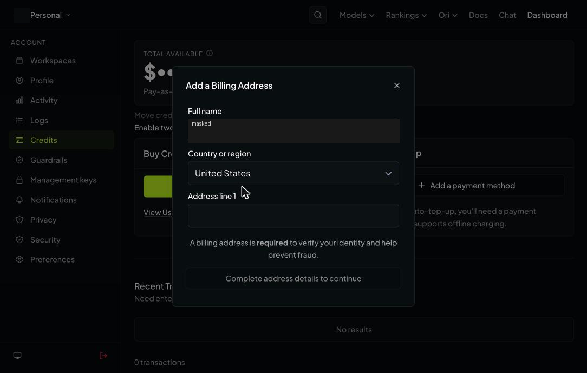

**Add credits → "Add a Billing Address"** (Stripe-hosted fields): Full name (prefilled, masked), Country or region, Address line 1, and more lines as you fill it in.

- "A billing address is **required** to verify your identity and help prevent fraud."
- The button stays disabled as **"Complete address details to continue"** until the address is valid.
- **Stopped here.** The amount presets, the fee line and the payment step come after this gate and weren't reached.

### What the public docs say instead

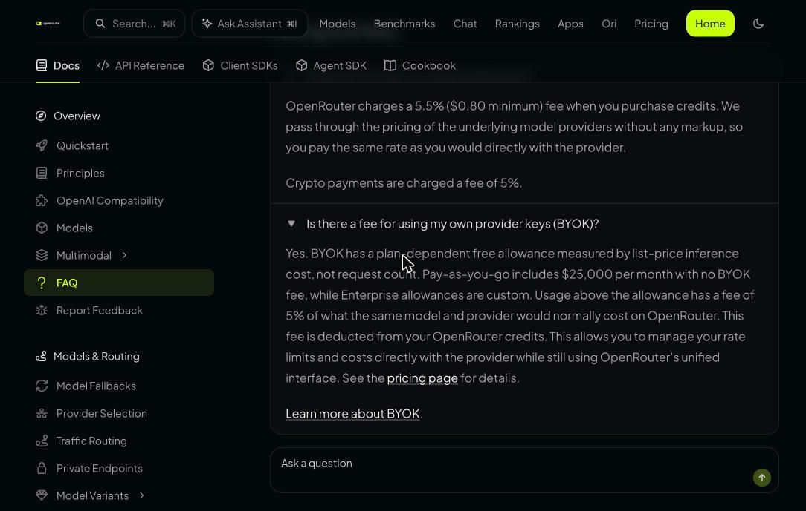 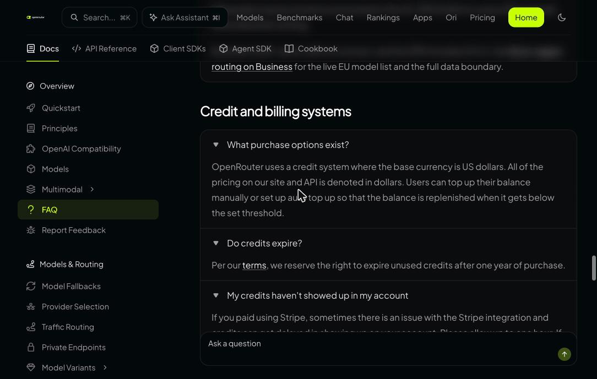 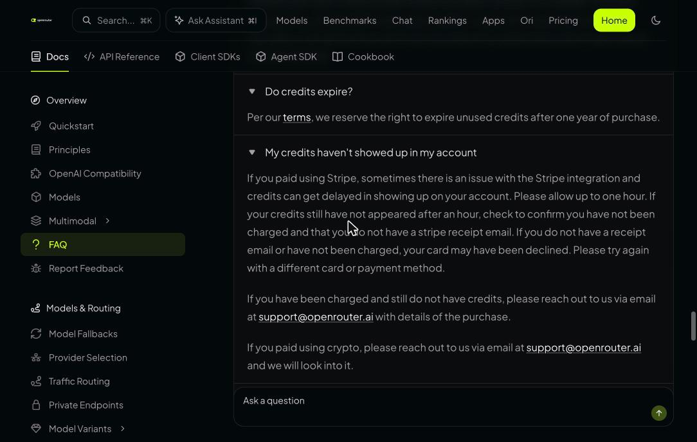 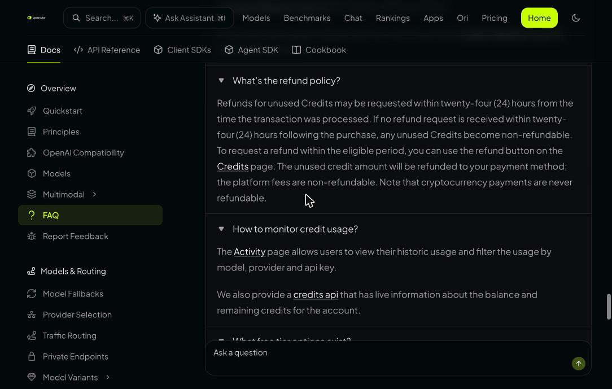 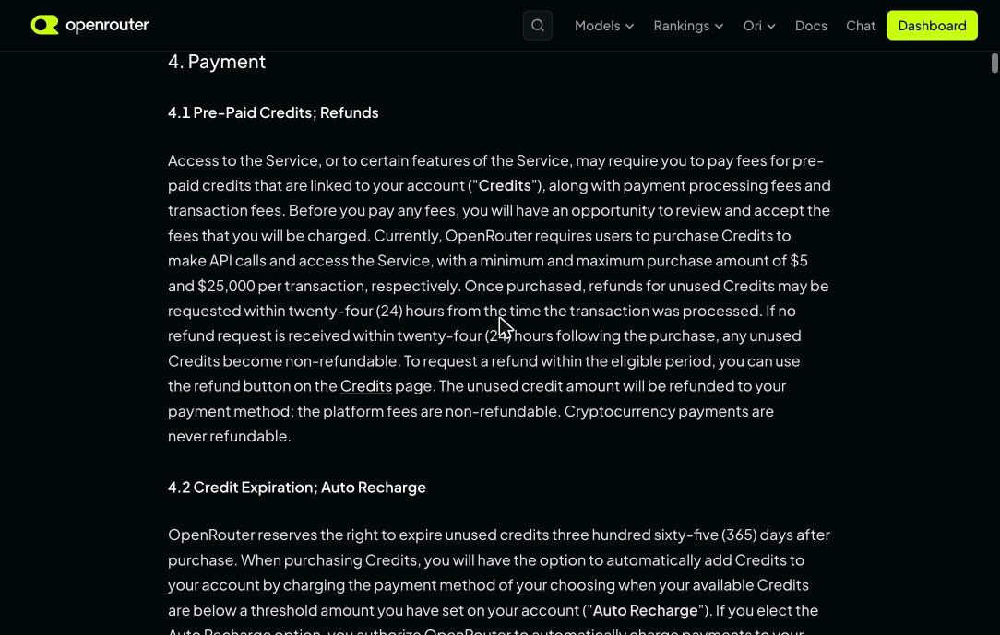 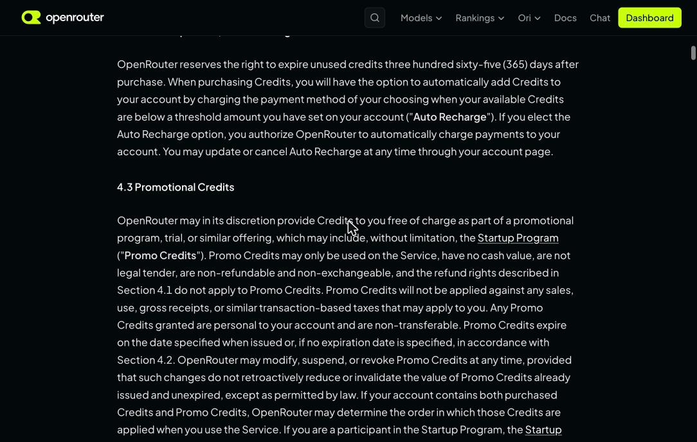

| Topic                        | Rule                                                                                                                                                                                                                      | Source                                               |
| ---------------------------- | ------------------------------------------------------------------------------------------------------------------------------------------------------------------------------------------------------------------------- | ---------------------------------------------------- |
| Currency                     | Credits are USD-denominated; all prices are in dollars                                                                                                                                                                    | Docs FAQ "What purchase options exist?"              |
| **Minimum / maximum top-up** | **$5 minimum, $25,000 maximum per transaction**                                                                                                                                                                           | Terms §4.1                                           |
| **Fee line**                 | **5.5% with an $0.80 minimum** on card purchases; **5% on crypto**; 8% on Business; no markup on inference                                                                                                                | Docs FAQ "What are the fees…", Pricing page          |
| Fee disclosure               | "Before you pay any fees, you will have an opportunity to review and accept the fees"                                                                                                                                     | Terms §4.1                                           |
| **Tax**                      | Prices exclude tax; **VAT/GST may be added on invoices** where required                                                                                                                                                   | Pricing FAQ "Are taxes (VAT/GST) included?"          |
| **Receipts / invoices**      | Stripe emails a receipt for card payments (the FAQ uses "no receipt email" to diagnose declined cards). The Credits page lists Recent Transactions with an Actions column. Enterprise gets invoices and POs through sales | Docs FAQ "My credits haven't showed up", Pricing FAQ |
| Delayed credits              | Allow up to 1 hour for Stripe; crypto issues go to support                                                                                                                                                                | Docs FAQ                                             |
| **Refunds**                  | Unused credits are refundable **within 24 hours** of purchase via the refund button on the Credits page. **Platform fees are non-refundable; crypto is never refundable**                                                 | Docs FAQ, Terms §4.1                                 |
| **Credit expiry**            | OpenRouter may expire unused credits **365 days after purchase**. Promo credits expire on their stated date or under the same rule                                                                                        | Docs FAQ, Terms §4.2–4.3                             |
| Payment methods              | Major cards, AliPay, USDC; PayPal "soon"; Enterprise invoicing                                                                                                                                                            | Docs FAQ, Pricing FAQ                                |
| **Amount presets**           | **Not documented publicly.** No preset buttons visible before the gate                                                                                                                                                    | —                                                    |

## 3. Auto top-up

 

- **In the app:** Credits → **Auto Top-Up** card shows only "+ Add a payment method — To activate auto-top-up, you'll need a payment method that supports offline charging." The settings appear only after a card that supports off-session charging is saved. Not done.
- **Documented behavior:**
  - FAQ: "top up their balance manually or set up auto top up so that the balance is replenished when it gets below the set threshold."
  - Terms §4.2 ("Auto Recharge"): you choose a payment method and a **threshold**. When available credits fall below it, OpenRouter charges that method automatically. You can update or cancel it at any time from the account page.
  - Each recharge is a normal credit purchase, so the **$5–$25,000 limits, the 5.5% fee and the 24-hour refund window** apply (Terms §4.1).
  - The Authentication docs warn that a key with no credit limit can spend "your entire balance, including any auto top-ups". Hence the advice to put a limit on every key.
- **Not documented publicly:** the exact field names, the recharge-amount field, and any monthly cap on auto-recharges.

## 4. Notifications (personal)

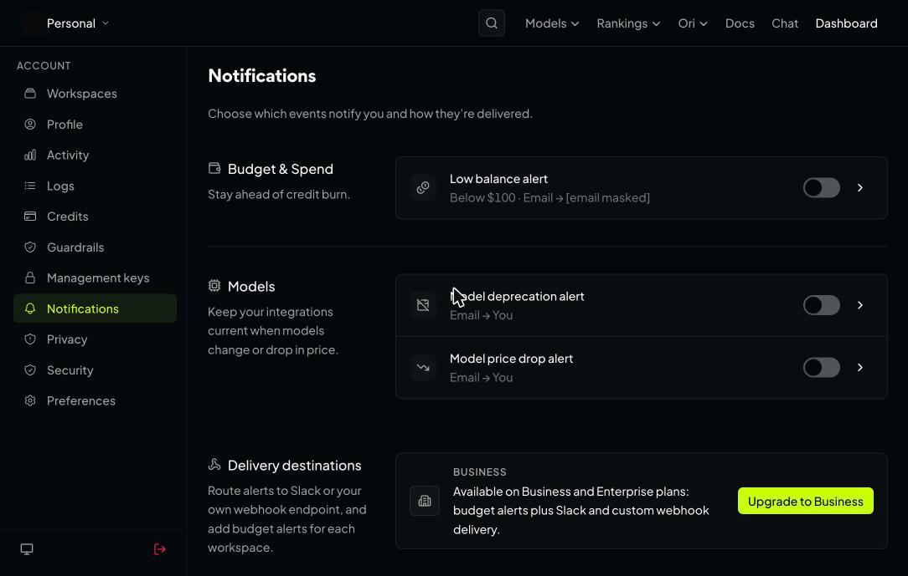 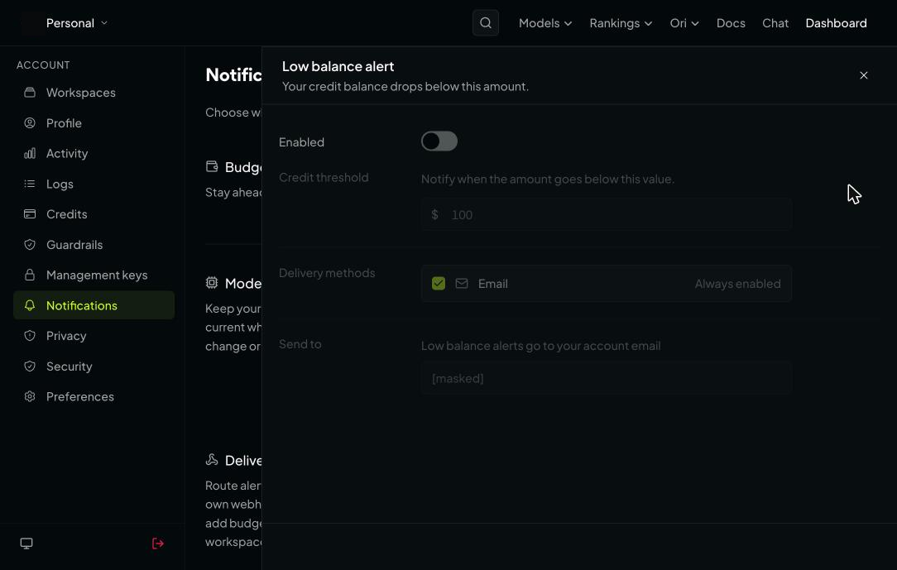 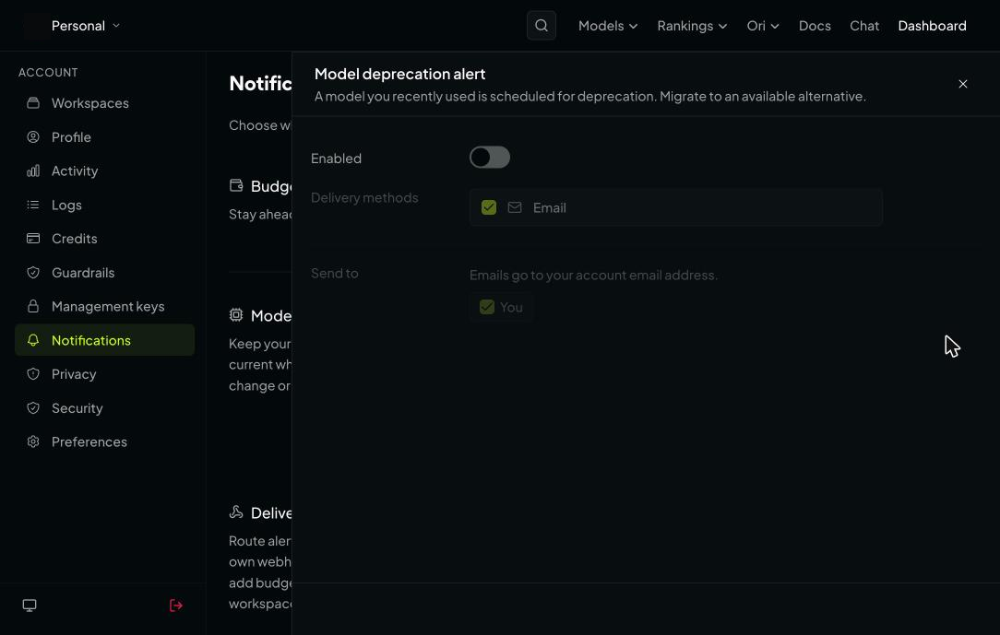 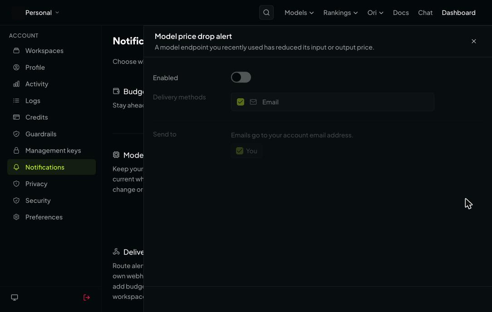

**URL:** `/settings/notifications` — "Choose which events notify you and how they're delivered." Each row has an on/off toggle and a › chevron that opens a side panel.

| Alert                                  | Trigger (panel text)                                                                           | Options                                                   | Delivery                                                   |
| -------------------------------------- | ---------------------------------------------------------------------------------------------- | --------------------------------------------------------- | ---------------------------------------------------------- |
| **Low balance alert** (Budget & Spend) | "Your credit balance drops below this amount."                                                 | Enabled toggle · **Credit threshold $** (default **100**) | Email, always enabled, to the account email (not editable) |
| **Model deprecation alert** (Models)   | "A model you recently used is scheduled for deprecation. Migrate to an available alternative." | Enabled toggle                                            | Email → "You"                                              |
| **Model price drop alert** (Models)    | "A model endpoint you recently used has reduced its input or output price."                    | Enabled toggle                                            | Email → "You"                                              |
| **Delivery destinations**              | Slack, custom webhook, per-workspace budget alerts                                             | —                                                         | **Business/Enterprise upsell** ("Upgrade to Business")     |

All three were off. Personal shows "You" where the org version shows "Org admins".

## 5. Workspace tools

### 5a. New workspace (cancelled)

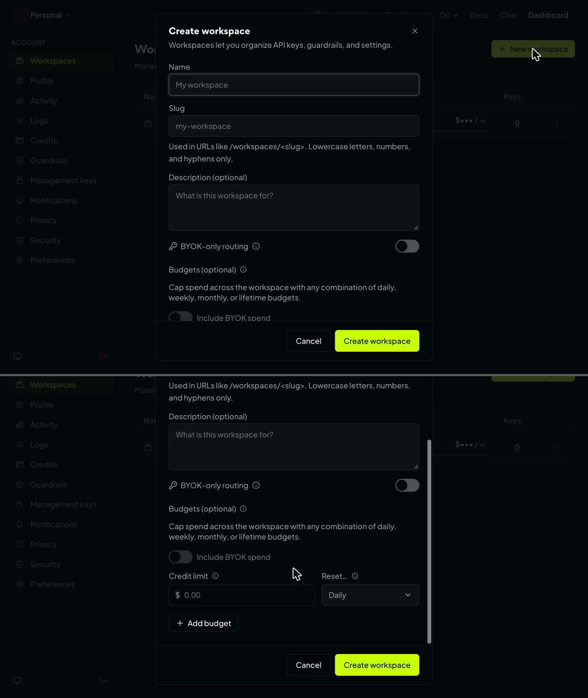

"Create workspace — Workspaces let you organize API keys, guardrails, and settings."

- **Name**; **Slug** ("Used in URLs like /workspaces/<slug>. Lowercase letters, numbers, and hyphens only.").
- **Description (optional)**.
- **BYOK-only routing** toggle (ⓘ).
- **Budgets (optional)** (ⓘ): "Cap spend across the workspace with any combination of daily, weekly, monthly, or lifetime budgets."
  - **Include BYOK spend** toggle.
  - **Credit limit $** with **Reset…** (Daily ▾).
  - **+ Add budget** to stack several budget windows.
- Cancel / Create workspace.
- **Difference from the org:** the personal dialog has **no Members picker**.

### 5b. Presets

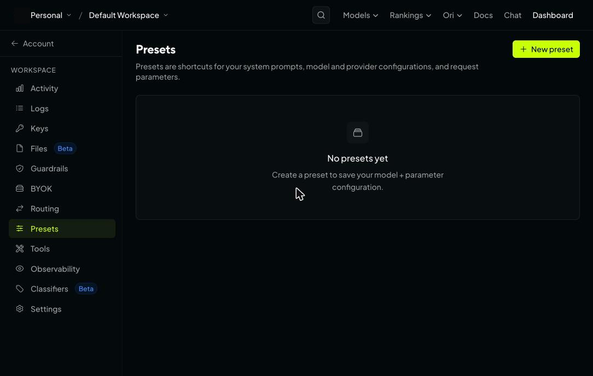 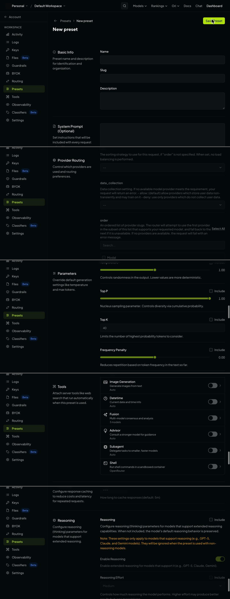

- **List:** "Presets are shortcuts for your system prompts, model and provider configurations, and request parameters." Empty state "No presets yet — Create a preset to save your model + parameter configuration." Button **+ New preset**.
- **New preset** is a full page, not a dialog: breadcrumb Presets › New preset, with **Save Preset** (not clicked). Sections:
  1. **Basic Info:** Name, Slug, Description.
  2. **System Prompt (optional):** free text added to every request.
  3. **Models:** "Model Selection (Optional): up to 3. Leave empty to allow any model. If multiple models are selected, they will be used as fallbacks." + Add model.
  4. **Provider Routing:** "Include Provider Preferences" checkbox, then the raw API fields, each with its description:
     - `sort` (dropdown, no load balancing when set) · `data_collection` (allow / deny).
     - `order` (ordered, searchable provider checklist with Select All) · `quantizations` (int4…fp32, unknown).
     - `max_price` (prompt and completion $/M) · `preferred_min_throughput` · `preferred_max_latency`.
  5. **Parameters:** each has an **Include** checkbox and a slider or input: Temperature (1.00), Top P (1.00), Top K (40), Frequency penalty (0), Presence penalty (0), Repetition penalty (1.00), Max tokens, Seed, and more.
  6. **Tools:** server tools with toggles and modes: Web Search, Web Fetch, Image Generation, Datetime, Fusion (3 models), Advisor, Subagent, Shell.
  7. **Caching:** Response Caching (Include) · Enable Caching · Cache TTL (default 5m).
  8. **Reasoning:** Include · Enable Reasoning · Reasoning Effort (Medium), noting it is ignored by non-reasoning models.
- **Main action (not performed):** Save Preset creates a slug. Apps reference it as a model (`@preset/<slug>`) or pick it in Chat.

### 5c. BYOK: add-key form for one provider (not saved)

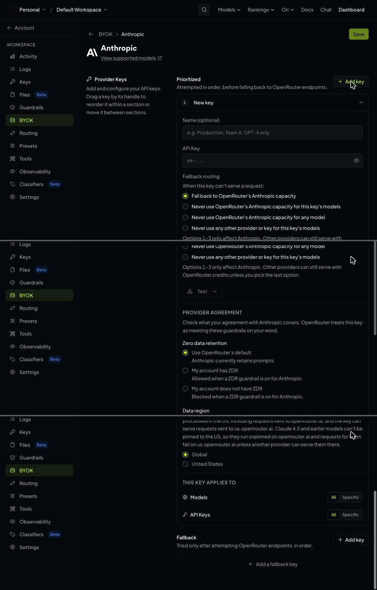

BYOK → **Anthropic** opens a page (breadcrumb BYOK › Anthropic, "View supported models ↗", **Save**). **Provider Keys** has two draggable sections, _Prioritized_ ("Attempted in order, before falling back to OpenRouter endpoints") and _Fallback_ ("Tried only after attempting OpenRouter endpoints"). **Add key** opens a "New key" card:

- **Name (optional)**, e.g. "Production, Team A, GPT-4 only".
- **API Key**: `sk-...`, masked, with a reveal 👁.
- **Fallback routing: "When this key can't serve a request:"**
  - (•) Fall back to OpenRouter's Anthropic capacity
  - ( ) Never use OpenRouter's Anthropic capacity for this key's models
  - ( ) Never use OpenRouter's Anthropic capacity for any model
  - ( ) Never use any other provider or key for this key's models
  - Note: options 1–3 only affect Anthropic; other providers can still serve with credits unless you pick the last option.
- **Test ▾**: test the key. Not clicked.
- **PROVIDER AGREEMENT:** "OpenRouter treats this key as meeting these guardrails on your word."
  - **Zero data retention:** Use OpenRouter's default ("Anthropic currently retains prompts") / My account has ZDR / My account does not have ZDR.
  - **Data region:** Global / United States. US pins Claude 4.6+ models to US processing and allows serving `us.openrouter.ai`.
- **THIS KEY APPLIES TO:** **Models** All / Specific · **API Keys** All / Specific (scope a provider key to certain OpenRouter keys).
- Leaving with ← discarded the draft. The page also has an "Unsaved changes — Keep editing / Discard changes" guard.

## 6. Models → Compare

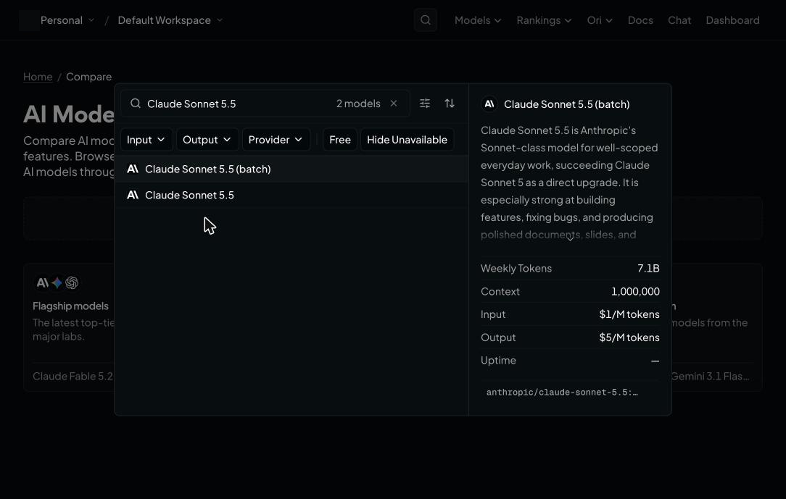 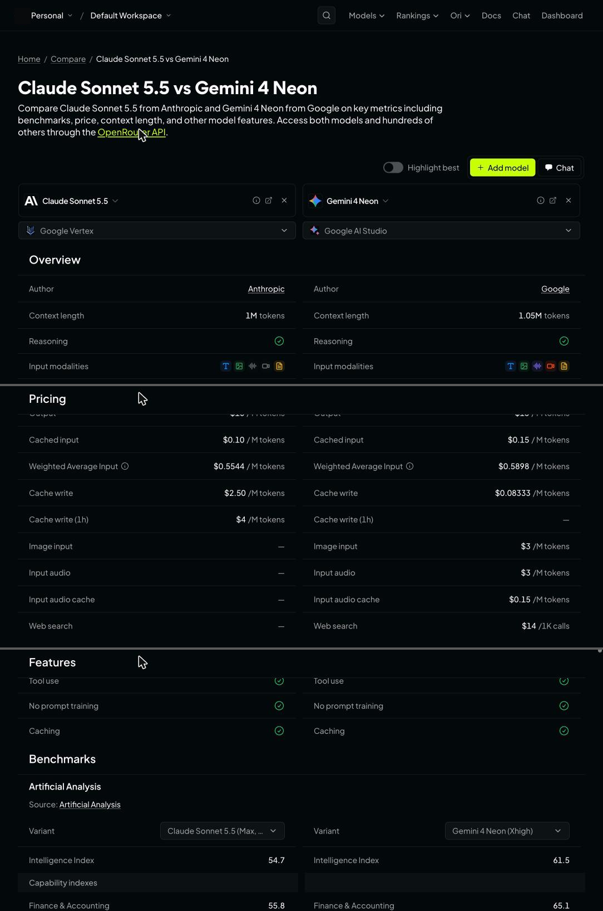

- **Empty `/compare`:** "AI Model Comparison", two **Select a model** slots, plus preset comparison cards (Flagship models, Best for code, Most affordable, Image generation).
- **Model picker:**
  - Search with a count, filters (Input, Output, Provider, Free, Hide Unavailable), view and sort icons.
  - Results include `(batch)` variants.
  - A preview pane shows description, Weekly Tokens, Context, Input/Output price, Uptime sparkline and slug.
- **URL:** `/compare/anthropic/claude-sonnet-5.5/google/gemini-4-neon` (shareable).
- **Header:**
  - **Highlight best** toggle, **+ Add model** (more than 2 columns), **Chat** (opens both in Chat).
  - Per column: model dropdown, ⓘ, ↗, ✕, and a **provider selector** (Google Vertex / Google AI Studio) that switches the numbers to that endpoint.
- **Sections** (side by side):
  - **Overview:** author, context (1M vs 1.05M), reasoning, input/output modalities, provider count (5 vs 2).
  - **Pricing:** input ($2 vs $3), output ($10 vs $15), cached input, **weighted average input** ($0.5544 vs $0.5898), cache write (5m/1h), image input, input audio and audio cache, web search ($/1K calls).
  - **Performance:** p50 latency (1.81 s vs 4.74 s), p50 throughput (112.5 vs 70 tok/s), "Visualize Performance".
  - **Features:** quantization, max output (128K vs 66K), stream cancellation, tool use, no prompt training, caching.
  - **Benchmarks:** Artificial Analysis with a variant picker per column (Intelligence and capability indexes), Design Arena, Vals AI.
  - Then **Activity** and **Analysis** (a generated side-by-side summary).

## 7. API errors for out-of-credits, key limit, expired or disabled key

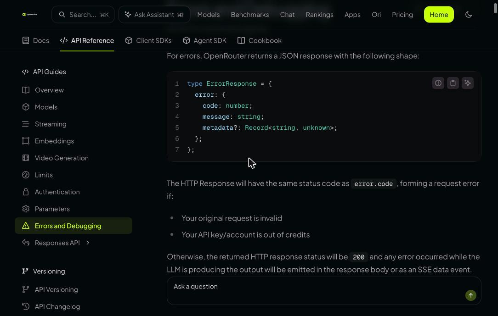 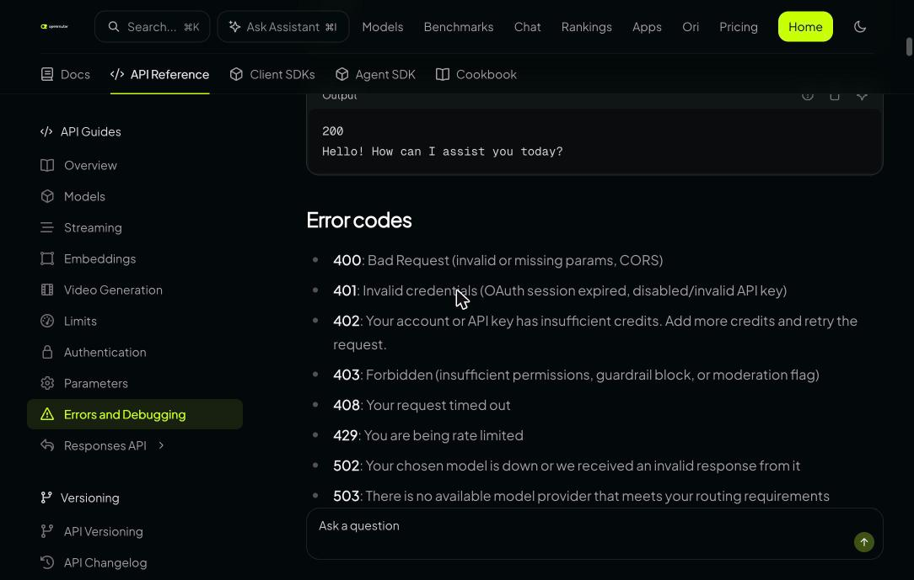 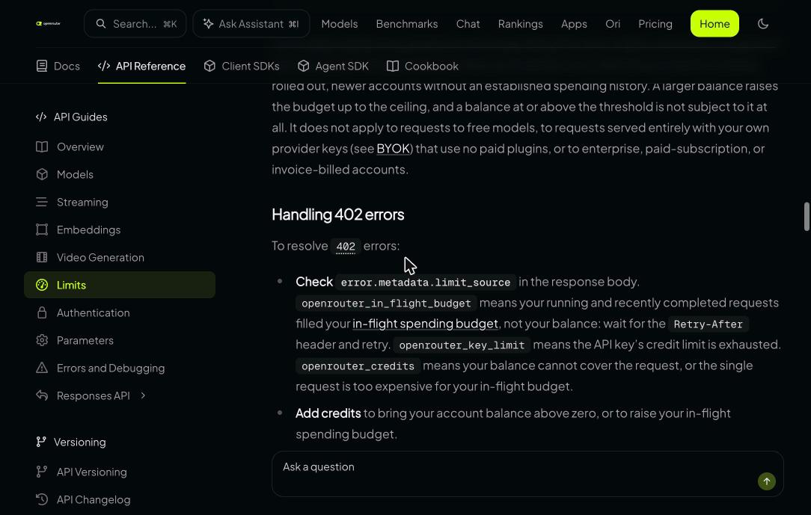 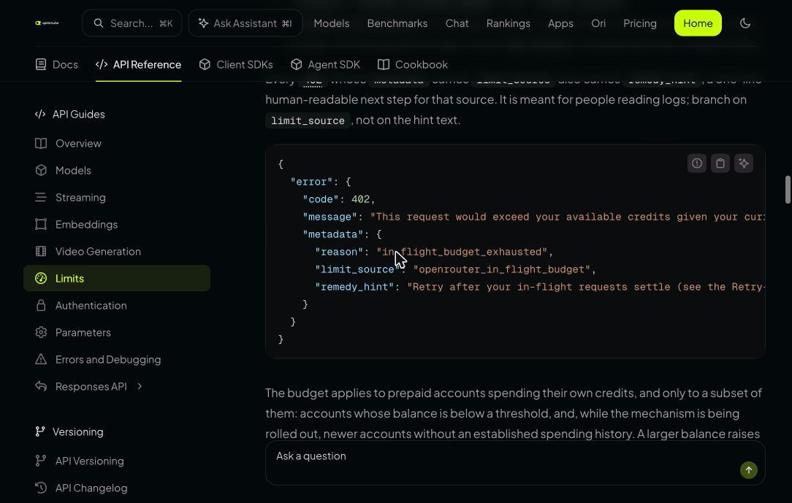

**Envelope** (Errors and Debugging): `{"error": {"code": number, "message": string, "metadata"?: {…}}}`. The HTTP status equals `error.code` when the request fails before generation, including when "your API key/account is out of credits". After generation starts, errors arrive in a 200 body or SSE event.

| Situation                                                          | HTTP                                                | Body / how to tell it apart                                                                                                                                                 | Source                                                    |
| ------------------------------------------------------------------ | --------------------------------------------------- | --------------------------------------------------------------------------------------------------------------------------------------------------------------------------- | --------------------------------------------------------- |
| **Credits run out** (balance can't cover the request)              | **402** Payment Required                            | `error.metadata.limit_source = "openrouter_credits"`. SDK docs show the message `"Insufficient credits. Add more using https://openrouter.ai/credits"`                      | Limits → Handling 402; Python SDK PaymentRequiredResponse |
| **Key credit limit reached**                                       | **402**                                             | `limit_source = "openrouter_key_limit"`. Fix by raising the key's limit or waiting for `limit_reset`. `GET /api/v1/key` shows `limit_remaining`                             | Limits → Handling 402                                     |
| In-flight spend budget full (newer, low-balance accounts)          | **402** + `Retry-After`                             | Full example in image 63: `reason: "in_flight_budget_exhausted"`, `limit_source: "openrouter_in_flight_budget"`, `remedy_hint`                                              | Limits                                                    |
| Single request costs more than the whole budget                    | **402**                                             | `reason: "weight_exceeds_budget"`, `limit_source: "openrouter_credits"`. Retrying won't help                                                                                | Limits                                                    |
| Guardrail / workspace budget exceeded                              | **403**                                             | `limit_source: "openrouter_guardrail_budget"` or `"openrouter_workspace_budget"`, with `scope`, `limit_usd`, `spend_usd`, `resets_at`, `remedy_hint`                        | Limits                                                    |
| **Key expired or disabled** (or invalid, or OAuth session expired) | **401** Unauthorized                                | "Invalid credentials — the API key is missing, invalid, disabled, or the OAuth session expired." The docs give no separate JSON example or sub-code for expired vs disabled | Errors → Error codes; Limits status table                 |
| Also listed                                                        | 400, 403 (moderation/guardrail), 408, 429, 502, 503 | —                                                                                                                                                                           | Errors → Error codes                                      |

Docs advice: every 402 with a `limit_source` also has a human-readable `remedy_hint`. Branch on `limit_source`, not the hint text. Check `GET /api/v1/key` proactively.

---

# Part D: API key lifecycle (one harmless write)

## 8a. Create

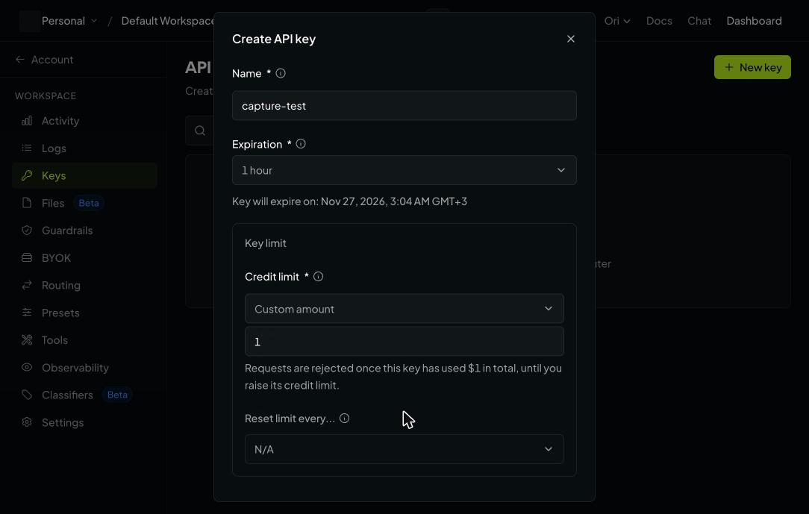

- **Name** `capture-test`.
- **Expiration** "1 hour", with a live preview "Key will expire on: Nov 27, 2026, 3:04 AM GMT+3".
- **Credit limit** "Custom amount" → **1**, with helper text "Requests are rejected once this key has used $1 in total, until you raise its credit limit."
- **Reset limit every…** N/A (options **N/A / Daily / Weekly / Monthly**).
- Clicked **Create**.

## 8b. "Your new key" (copy once)

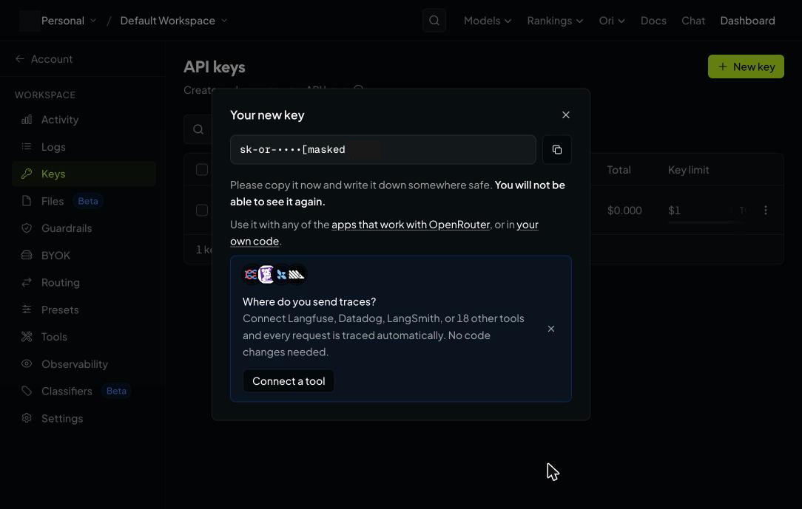

- The secret is shown in a read-only field with a copy button. It's masked here, including the last characters.
- "Please copy it now and write it down somewhere safe. **You will not be able to see it again.**"
- Links: "apps that work with OpenRouter", "your own code".
- Upsell card: "Where do you send traces? Connect Langfuse, Datadog, LangSmith, or 18 other tools…" with Connect a tool / Dismiss.

## 8c. Key row

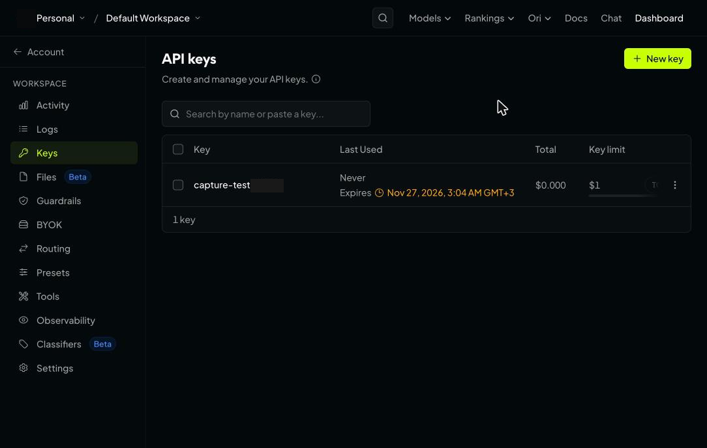 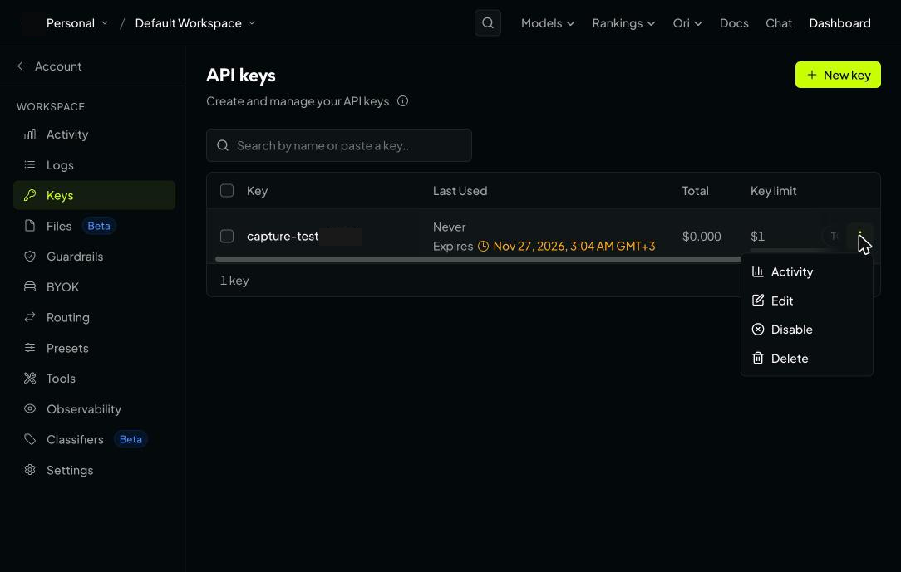

- Columns: checkbox · **Key** (name + last 3 characters, masked) · **Last Used** ("Never") with **Expires** shown in amber because expiry is under 1 h · **Total** ($0.000) · **Key limit** ($1 with a usage bar and a "TOTAL" reset badge) · ⋮.
- Row menu: **Activity · Edit · Disable · Delete**.

## 8d. Edit (key detail page)

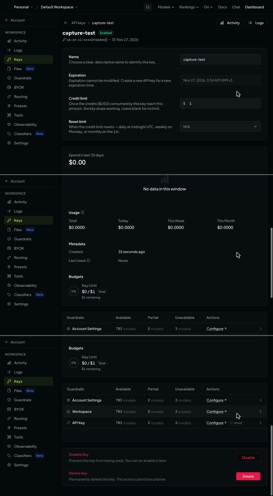

- **Edit** opens a page, not a dialog: `API keys › capture-test`, status badge **Enabled**, masked key prefix, created date, and **Activity** / **Logs** shortcuts.
- **Editable fields:**
  - **Name.**
  - **Expiration:** read-only, "cannot be modified. Create a new API key for a new expiration time."
  - **Credit limit $1:** "Once the credits consumed by this key reach this amount, the key stops working. Leave blank for no limit."
  - **Reset limit:** N/A / daily at midnight UTC / weekly on Monday / monthly on the 1st.
- **Spend in last 30 days** chart ($0.00, "No data in this window").
- **Usage:** Total / Today / This Week / This Month (4 decimals).
- **Metadata:** Created ("35 seconds ago"), Last Used (Never).
- **Budgets:** Key Limit ring 0%, "$0 / $1 Total, $1 remaining".
- **Guardrails** table (Available / Partial / Unavailable models): Account Settings · Workspace · **API Key** ("Unset") with Configure ↗.
- **Danger zone:** **Disable Key** ("Prevent this key from being used. You can re-enable it later.") and **Delete Key** ("Permanently delete this key. This action cannot be undone.").

## 8e. Disable confirmation

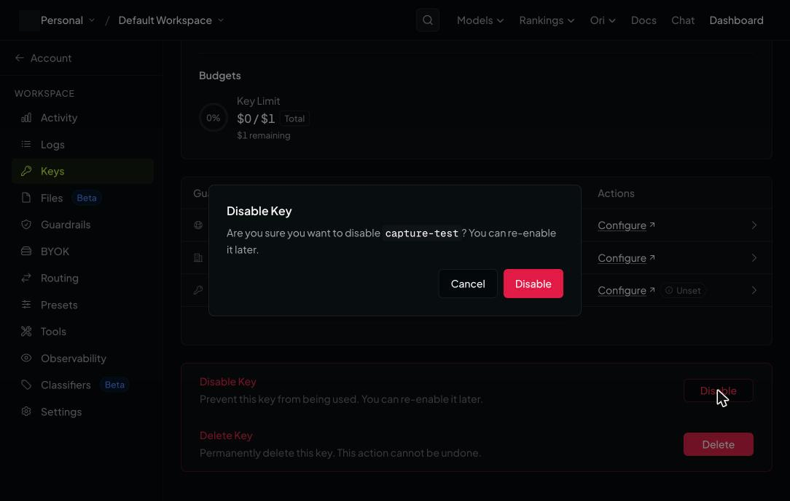
Modal "Disable Key — Are you sure you want to disable `capture-test`? You can re-enable it later." with **Cancel** / **Disable** (red). **Cancel** was clicked, because the key was deleted right after. Disabling would flip the badge to Disabled, and the key would get **401** on use (see §7).

## 8f. Delete confirmation, then result

 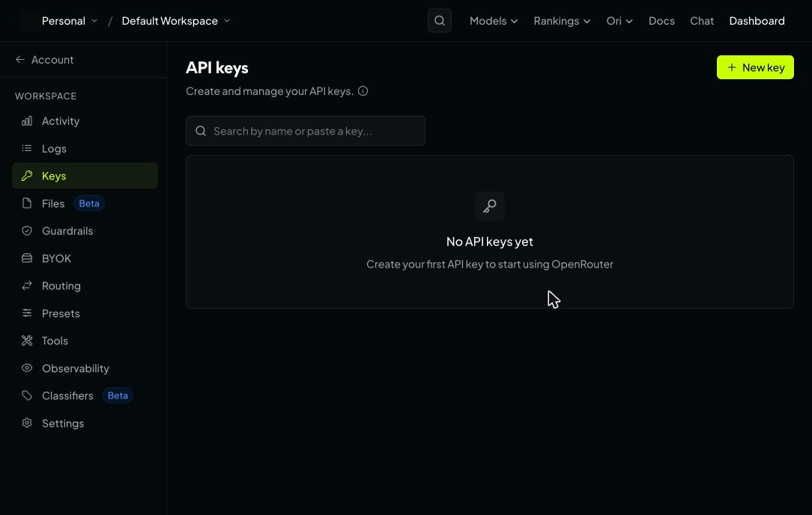

- Modal "Delete Key — Are you sure you want to delete `capture-test`? This action cannot be undone." with **Cancel** / **Delete**. **Delete** was clicked.
- Result: redirect to API keys showing the empty state "No API keys yet". No toast was observed.

---

## Gateway features to copy (from this pass)

- [ ] An onboarding wizard that asks individual vs org, collects org name and invites, and mints a **capped, expiring starter key** with a copy-paste first request.
- [ ] Billing-address/KYC gate before the first purchase. Per-transaction min/max ($5 / $25k). A fee shown before payment (percentage with a dollar minimum, a different rate for crypto). A 24-hour self-serve refund of unused credit with a non-refundable fee. A 365-day credit expiry policy. Tax added on invoices. Receipts.
- [ ] Auto-recharge: threshold-triggered charge on a saved off-session payment method, editable and cancellable, with every recharge obeying purchase limits, fees and refund rules.
- [ ] Notifications: low balance (configurable threshold), model deprecation and price drops for models you actually used; email by default, Slack/webhook on higher tiers; recipients are "you" or "org admins".
- [ ] Workspaces with slug, BYOK-only mode and stacked budgets (daily/weekly/monthly/lifetime, BYOK spend optional).
- [ ] Presets: named, slugged bundles of system prompt, up to 3 fallback models, provider-routing fields (sort, data_collection, order, quantizations, max_price, throughput/latency preferences), per-parameter "include" overrides, server tools, response caching with TTL, and reasoning settings.
- [ ] BYOK per provider: multiple keys in ordered Prioritized and Fallback groups, four fallback policies, a key test, self-declared ZDR and data region, and scoping to specific models or gateway keys. Unsaved-changes guard.
- [ ] Compare page: N models, a provider selector per column, highlight best, shareable URL, sections for overview, pricing (incl. weighted average), performance, features, benchmarks and activity.
- [ ] Error contract: one envelope; 402 with a machine-readable `limit_source` (credits, key limit, in-flight budget) plus `reason` and `remedy_hint`; 403 for guardrail/workspace budgets with limit, spend and reset; 401 for invalid, disabled or expired keys; `Retry-After` where retry makes sense; a `GET /key` endpoint for remaining limit.
- [ ] Key lifecycle: name, required expiry (immutable after creation), credit limit with reset (N/A, daily UTC, weekly Monday, monthly 1st), show-once secret, per-key detail page (usage periods, budget ring, guardrail layers, activity/logs links), disable (reversible) and delete (irreversible) confirmations.

---

## Could not capture, and why

1. **Wizard re-trigger and steps 4–6.** The account already finished onboarding, and neither reloads nor an `/onboarding` URL bring it back. Images 40–42 are from earlier in this session. Steps 4–6 were completed by the owner before capture, and the Organization-selected state of step 1 was never captured.
2. **Amount presets, the purchase fee line, the tax line and the confirm screen.** All sit behind the **billing-address gate**, which needs a real address (not allowed). Presets and min/max are not on the docs pages; min/max comes from the Terms of Service.
3. **Invoices/receipts in the app.** The account has **0 transactions**, so the Actions/receipt links don't exist yet. Documented from the FAQ and pricing page instead.
4. **Auto top-up settings form.** It appears only after saving an off-session-capable card (not allowed). No public docs page lists its exact fields (recharge amount, caps); only the threshold concept is documented (FAQ, Terms §4.2).
5. **Disabled-key state.** The Disable confirmation was captured but cancelled, so the "Disabled" badge and re-enable control weren't captured. The key was then deleted as instructed.
6. **Exact 401 bodies for expired vs disabled keys and a dedicated key-limit JSON example.** The docs list 401 for "disabled/invalid API key" and document `limit_source: "openrouter_key_limit"` for key limits, but show no specific JSON sample for these. Producing them live would need a failing paid call or a disabled key, which is outside the read-only rules.
7. **BYOK "Test" and saving a provider key.** Not clicked: it needs a real provider secret and would save configuration.
8. **A success toast after delete.** None appeared within 3 seconds. The empty key list confirms the deletion.

Sources: [OpenRouter FAQ](https://openrouter.ai/docs/faq) · [Terms of Service §4](https://openrouter.ai/terms) · [Pricing FAQ](https://openrouter.ai/pricing) · [API Limits](https://openrouter.ai/docs/api/reference/limits) · [Errors and Debugging](https://openrouter.ai/docs/api/reference/errors-and-debugging) · [Authentication](https://openrouter.ai/docs/api_reference/authentication) · [Python SDK PaymentRequiredResponse](https://openrouter.ai/docs/client-sdks/python/errors/paymentrequiredresponseerror.md)
