# OpenRouter product flows — reference for building an equivalent gateway

Captured 27 Nov 2026 (GMT+3) from a logged-in **personal account on the Standard (pay-as-you-go) plan**. The account and its only workspace were new, so the balance, usage, logs and keys were all empty. Usage pages are documented from their empty states and controls. Section 7 explains charging using the in-app columns plus OpenRouter's public docs and pricing FAQ.

**How this was captured (read-only)**

- Nothing was purchased, created, deleted or saved. Dialogs (Add credits, Create API key, chat Advanced settings) were opened, then closed with ✕ / Esc.
- A first-run "Welcome to OpenRouter" wizard (Individual vs Organization) covers every page. Finishing it would save an account choice, so it was **hidden client-side only**. It will come back on reload.
- Before each capture, emails, balances, spend amounts and workspace IDs were masked in the page. The prefilled billing name and the avatar initial were blacked out in the image files.
- The browser only captures the visible viewport (1084×689). "Full-page" images are stitched from scrolled frames, with a grey divider between frames. Sticky sidebars and headers repeat in each frame. The long model-detail page shows only its key sections.
- Model names, prices and stats shown are public catalog data, not account data.

---

## 1. Models catalog

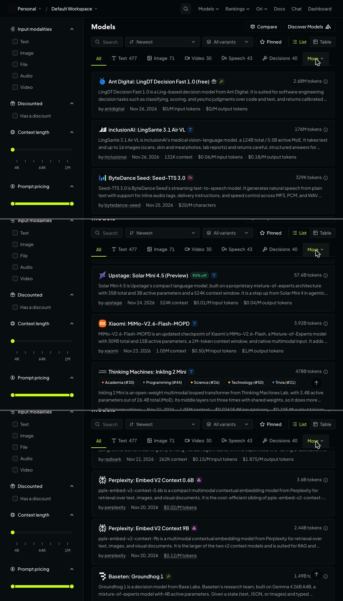
Extras: [01a sort menu](01a-models-sort-menu.png) · [01b table view + search](01b-models-table-search.png) · [01c empty state](01c-models-empty-state.png)

**URL / purpose:** `https://openrouter.ai/models` — browse, filter, sort and compare every model the gateway offers (≈660 models at capture time).

**Layout (top → bottom)**

1. Global header: account switcher ("Personal") / workspace switcher ("Default Workspace"), global search, nav menus (Models, Rankings, Ori, Docs, Chat, Dashboard).
2. Left filter sidebar, collapsible accordions (see below).
3. Main column: page title "Models" + **Compare** and **Discover Models** buttons.
4. Toolbar: search box, sort dropdown, variant dropdown, **Pinned** toggle, **List / Table** view switch.
5. Modality tabs with counts: All · Text 477 · Image 71 · Video 30 · Speech 43 · Decisions 40 · More ▾ (embeddings, etc.).
6. Results: infinite-scroll card list (or a table), back-to-top button, then a large footer.

**Controls**

| Control                   | What it does                                                                                                                                                                                                                                                                                                                            |
| ------------------------- | --------------------------------------------------------------------------------------------------------------------------------------------------------------------------------------------------------------------------------------------------------------------------------------------------------------------------------------- |
| Search ("Search models…") | Live text filter. Typing switched the sort to _Top Weekly_ and updated the tab counts (e.g. "claude" → Text 36).                                                                                                                                                                                                                        |
| Sort dropdown             | Most Popular, Newest, Oldest, Top Weekly, Weekly Tokens ↑, Discount high→low, Pricing ↑/↓, Context ↑/↓, Throughput ↑/↓, Latency ↑/↓, Artificial Analysis Intelligence Index plus 10 domain indexes (Finance, Strategy & Ops, Legal, Healthcare, Engineering, Economics, Cyber, Openness, Multilingual, Decision), Design Arena ELO ↑/↓. |
| Variant dropdown          | All variants · Standard · Free · Batch (`:free` / batch versions of a model are separate SKUs).                                                                                                                                                                                                                                         |
| Pinned                    | Show only models the user starred (star icon on each detail page).                                                                                                                                                                                                                                                                      |
| List / Table              | Card list vs a dense table.                                                                                                                                                                                                                                                                                                             |
| Table gear                | Choose which table columns to show.                                                                                                                                                                                                                                                                                                     |
| Modality tabs             | Filter by output type.                                                                                                                                                                                                                                                                                                                  |
| Compare                   | Opens `/compare` (side-by-side model comparison).                                                                                                                                                                                                                                                                                       |
| Discover Models           | Opens `/discover` (curated collections).                                                                                                                                                                                                                                                                                                |

**Sidebar filters:** Input modalities (Text, Image, File, Audio, Video checkboxes) · Discounted ("Has a discount") · Context length slider (4K–64K–1M) · Prompt pricing range slider (FREE–$0.50–$10+ per 1M) · Output pricing slider (FREE–$2–$30+) · Series (GPT, Claude, Gemini, More…) · Categories (Programming, Roleplay, Marketing, More…) · Supported parameters (tools, temperature, top_p, More…) · Distillable (Yes/No) · Zero data retention (Supported) · In-region routing (EU/US) · Model age (New → 12+ mo) · Tool calling success (0–100%) · Throughput (0 → 1K+ tok/s) · Inactive models (Show deprecated) · Artificial Analysis and Design Arena score filters · Providers (AI21, AionLabs, AkashML… More) · Model authors.

**Data shown**

- _List card:_ author logo, "Author: Model name", badges (free gift icon, modality icons, "70% off" discount pill, category rank chips such as "Programming (#44)"), tokens processed in the last 7 days (e.g. "478B tokens", with an ⓘ tooltip), a 2-line description, then a meta line: `by author · release date · 1.05M context · $0.50/M input tokens · $1/M output tokens`.
- Non-token units appear where relevant: TTS "$20/M characters", embeddings "$0.02/M tokens" (one price).
- _Table columns:_ Model Name · Weekly usage (tokens) · Input · Output (USD per 1M tokens, e.g. "$4", "$0.10") · Context (full integer, e.g. 1,000,000) · Latency ("3.9s", "623ms") · Throughput ("87 t/s") · Released (relative, "2mo ago"). "—" means no data, e.g. for alias models like "Claude Opus Latest".
- **Money format:** USD, per million tokens. Trailing zeros are dropped in lists ("$2", "$0.02625"); detail tables use fixed decimals ("$2.00").

**States:** Empty search → card "No matching models found for your search." and every tab count drops to 0. No loading or error state appeared.

**Main action:** Clicking a model opens its detail page. The author link opens the author's page.

---

## 2. Model detail page

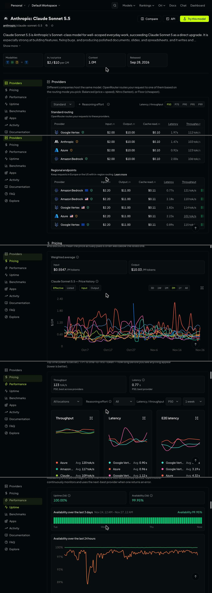
Extra: [02a provider drawer](02a-model-provider-drawer.png)

**URL / purpose:** `https://openrouter.ai/anthropic/claude-sonnet-5.5` — everything about one model: who serves it, what it costs, how fast and reliable each provider is, and how to call it.

**Layout (top → bottom)**

1. Header: logo, name, slug `anthropic/claude-sonnet-5.5` with copy button ("Model identifier for use in the API") and ☆ Pin. Buttons: **Compare**, **API**, **Try this model** (opens Chat). The header turns into a sticky compact bar on scroll.
2. Description with "Show more".
3. Four stat tiles: Modalities (input icons → output icons) · In/out price "$2 / $10 per 1M" · Context "1.0M" · Released.
4. Sticky left section nav: Providers, Pricing, Performance, Uptime, Benchmarks, Apps, Activity, Documentation, FAQ, Explore.
5. Sections:
   - **Providers.** Intro text: requests route to one provider based on the routing mode, Balanced (price + speed), Nitro (fastest) or Floor (cheapest).
     - Routing mode dropdown: Standard / Nitro / Floor / Batch. "+ Reasoning effort" filter. Latency/throughput percentile toggle: P50 / P75 / P90 / P95 / P99.
     - "Standard routing" table: Provider · Input /M · Output /M · Cache read /M · Latency · Throughput · Uptime (sparkline + %). Rows here: Google Vertex, Claude Platform on AWS, Anthropic, Azure, Amazon Bedrock, all $2.00 / $10.00 / $0.10 cache read.
     - Each row has a privacy shield icon: green = "Privacy: Private", orange = "Privacy: Logs".
     - "Regional endpoints" table: the same columns with EU 🇪🇺 / US 🇺🇸 flags. Regional pricing is about +10% ($2.20 / $11.00 / $0.11).
   - **Pricing.**
     - "Weighted average" tiles show the price customers actually pay after caching and discounts (Input $0.5547/M vs list $2; Output $10.03/M).
     - Price-history line chart with toggles: Effective / Listed, Input / Output, range 3D/1W/1M/3M/1Y/All. Share and expand buttons.
     - Per-provider table: Effective in /M · Effective out /M · Cache hit rate · Token share (1d), with a visibility toggle per provider.
   - **Performance.**
     - Headline tiles: Throughput "123 tok/s (P50, best across providers)" and Latency "0.77 s (P50, best provider)".
     - Filters: location, reasoning effort, percentile, window (1 week).
     - Small-multiple charts, each with a per-provider "Avg" legend: Throughput, Latency, E2E latency, Tool-call error rate, Structured-output error rate, Cache hit rate.
   - **Uptime.**
     - Uptime (3d) 100.00% means a provider was reachable. Availability (3d) 99.95% means inference was actually returned; errors and empty responses count against it.
     - 3-day bar strip, plus a 24-hour line chart comparing Availability with routing (99.96%) against **"Without Routing" (97.89%)**. This is how the product shows the value of fallback.
     - Copy notes that per-provider uptime is available through the Endpoints API.
   - **Benchmarks.** External scores (Artificial Analysis indexes, Design Arena, Vals AI) with rank among evaluated models.
   - **Apps.** Top apps using the model. **Activity.** Usage over time.
   - **API.** Get your API key, Make your first request, Using third-party SDKs, Enable streaming, Endpoint, Parameters.
   - Then: "Available through EU in-region routing", Documentation, Popular comparisons, FAQ (cost, context, tools, modalities, providers, release), Explore more models.

**Provider drawer** (click a provider row; prev/next arrows page through "1 / 10" providers):

- "Use this endpoint directly" button. Tiles: Latency, Throughput, Uptime, Input, Output, Context. Recent-uptime strip with a Status page link.
- Pricing: input, output, cache read, cache write (5m) **$2.50/M**, cache write (1h) **$4.00/M**.
- **Specifications:** Context 1M, Max output 128K, Region global, Precision.
- **Data policy:** Prompt training No · Retention Zero retention · ZDR compatible Yes · Moderation "Responsibility of developer" · Anonymity "Requires user IDs".
- **Features:** stream cancellation support, plus supported parameters (reasoning, max_tokens, response_format, tool_choice, tools, verbosity, stop).
- **Usage:** effective input/output price, cache hit rate, token share, tokens served.
- **Provider info:** status page, "BYOK supported", headquarters.

**States:** "—" where there's no data. Uptime colors: green bars healthy; the orange "without routing" line shows dips.

**Main action:** "Try this model" opens Chat with the model preselected. "API" shows a drop-in code panel ("Your key, drop-in code and the LLMs.txt for anthropic/claude-sonnet-5.5", Copy LLMs.txt, View docs).

---

## 3. Chat / playground

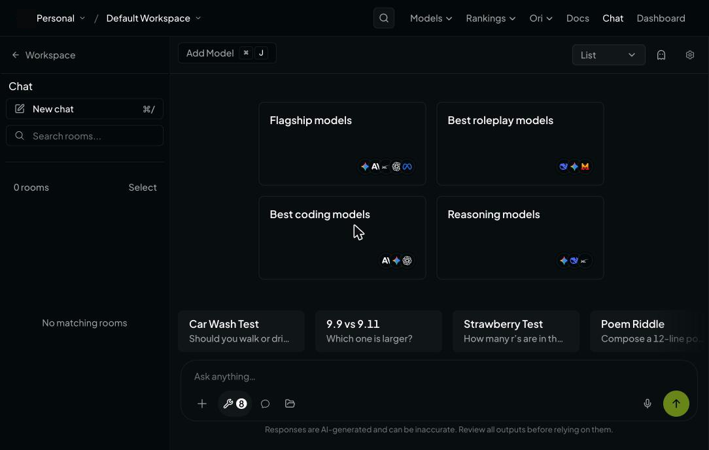
Extras: [03a model picker](03a-chat-model-picker.png) · [03b two models added for comparison](03b-chat-compare-two-models.png) · [03c per-model advanced settings](03c-chat-advanced-settings.png) · [03d room menu](03d-chat-room-menu.png)

**URL / purpose:** `https://openrouter.ai/workspaces/default/chat` — multi-model chat for trying and comparing models. Usage is billed to the workspace like API calls.

**Layout**

1. Left rail: ← Workspace, "Chat", **New chat** (⌘/), "Search rooms…", "0 rooms" + Select (bulk select), list of rooms (empty: "No matching rooms").
2. Top bar: **Add Model** (⌘J), added-model chips, layout dropdown, incognito/ghost toggle, ⚙ room menu.
3. Center: preset cards (Flagship models, Best roleplay models, Best coding models, Reasoning models) with provider icons. Clicking one adds that model set.
4. Prompt chips (Car Wash Test, 9.9 vs 9.11, Strawberry Test, Poem Riddle, Personal Finance…).
5. Composer: "Ask anything…" with buttons Add to message (+), Tools (badge: 8 active), Chat memory (all messages), Attach uploaded file, Start recording (mic), Send. Footer disclaimer about AI-generated responses.

**Choosing a model:** The Add Model popover has search ("467 models"), a filter menu (Input/Output modality, Provider, Free, Hide Unavailable), and a list grouped by release month. Enter adds the highlighted model as a chip.

**Comparing models:** Add several chips (here Claude Sonnet 5.5 + Claude Haiku 5.5). One prompt is sent to all of them. The layout dropdown offers **List** or **Side by side**.

- Hovering a chip shows: Choose model color · Disable reasoning · Hide model · Duplicate model (same model, different params) · Advanced settings.

**Parameters (Advanced settings dialog, per model chip):**

- Display name + enabled toggle · Model selector · **Preset** (saved config) · **Provider**: Auto or a pinned provider, plus "Sort By" · **Require Zero Data Retention** toggle.
- **Enable Streaming** · **File Parser Engine** · **Enable Reasoning** + **Reasoning Effort** (Medium).
- **System Prompt**: Default (OpenRouter's, shown with token estimate "~173 tokens") or Custom.
- **Sampling Parameters** (collapsible sliders + numeric inputs): Max tokens, Temperature, Top P, Top K, Frequency penalty, Presence penalty, Repetition penalty, Min P, Top A.
- Footer: **Apply to All** (copy settings to every chip) · Reset · Remove.

**Room menu (⚙):** Export · Import · Get Markdown · Share Models · Import Character · Duplicate Room (⌘⇧Y) · Clear Models (⌘⇧X) · Clear Chat (⌘⇧⌫) · toggles "Always expand messages" and "Show metrics inline" (per-message tokens/cost/latency) · Message color.

**States:**

- Empty: "No matching rooms".
- Error dialog found in the page (not triggered): **"Insufficient credits — Add credits to continue using paid models. [Buy credits] or [Continue with free models]."** This is the zero-balance fallback.

**Main action (not performed):** Send posts the message to each selected model in parallel and streams the replies into list or columns. With metrics inline, each reply shows its usage. A room is created and listed in the left rail.

---

## 4. Credits (balance, purchase, payment methods, auto top-up, receipts)

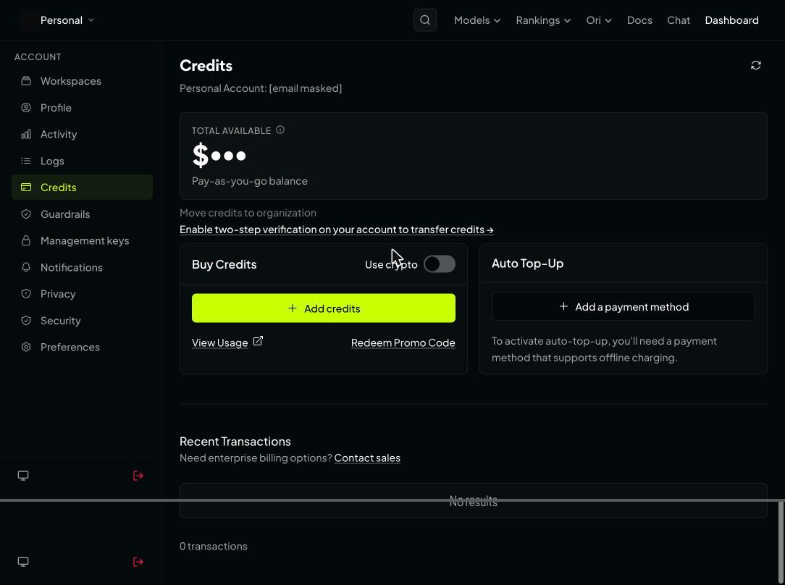
Extra: [04a purchase dialog — billing-address gate](04a-credits-billing-address-gate.png)

**URL / purpose:** `https://openrouter.ai/settings/credits` — account-level prepaid balance and how to fund it.

**Layout**

1. Account sidebar (ACCOUNT): Workspaces, Profile, Activity, Logs, **Credits**, Guardrails, Management keys, Notifications, Privacy, Security, Preferences. Footer: theme toggle, sign out.
2. Title "Credits", subtitle "Personal Account: [email]", refresh ↻ button.
3. **TOTAL AVAILABLE** tile: large balance in USD ($ with 2 decimals; masked here), "Pay-as-you-go balance", ⓘ tooltip.
4. "Move credits to organization" with a gate link: "Enable two-step verification on your account to transfer credits →".
5. Two cards:
   - **Buy Credits:** "Use crypto" toggle (switches checkout to crypto), **+ Add credits** primary button, "View Usage ↗", "Redeem Promo Code".
   - **Auto Top-Up:** "+ Add a payment method", plus the note "To activate auto-top-up, you'll need a payment method that supports offline charging."
6. **Recent Transactions** ("Need enterprise billing options? Contact sales"): table **Date · Amount · Actions**, footer "0 transactions".

**Purchase flow (stopped at step 1):** Add credits → modal **"Add a Billing Address"**: Full name (prefilled from profile), Country/region, Address line 1, then more fields. "A billing address is required to verify your identity and help prevent fraud." The button stays disabled ("Complete address details to continue") until the address is complete. It runs in an embedded payment-processor iframe. The amount step, the platform fee line and payment confirmation come after this; I didn't proceed.

**Payment methods:** Cards are added through "Add a payment method" (same embedded form), and the card must support **offline/off-session charging** to enable auto top-up. Crypto is a separate path.

**Auto top-up (inferred from the card):** After a qualifying payment method is added, the card shows its configuration (a threshold that triggers a recharge, and the recharge amount).

**Invoices/receipts:** Each transaction row has an **Actions** column, where receipt/invoice links appear per purchase. With 0 transactions, none were visible. Enterprise invoicing is "Contact sales".

**States:** Empty transactions "No results / 0 transactions". The transfer is gated behind 2FA, and the purchase is gated behind a billing address.

---

## 5. Activity / usage

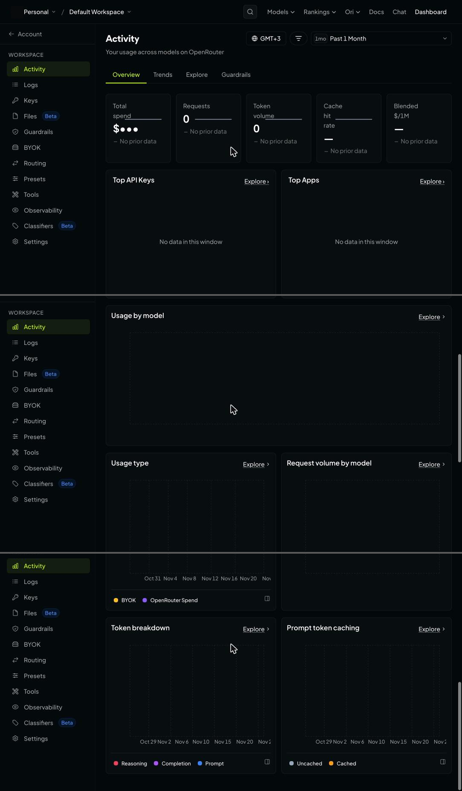
Extras: [05a filters](05a-activity-filters.png) · [05b Explore (pivot) tab](05b-activity-explore.png) · [05c Logs (per-request)](05c-logs.png)

**URL / purpose:** `https://openrouter.ai/workspaces/default/activity` (the workspace "Dashboard"; an account-wide Activity also exists) — spend and usage analytics.

**Layout**

1. Workspace sidebar (WORKSPACE): Activity, Logs, Keys, Files (Beta), Guardrails, BYOK, Routing, Presets, Tools, Observability, Classifiers (Beta), Settings. "← Account" goes back to the account level.
2. Header: "Activity — Your usage across models", **timezone** button (GMT+3), **filter** button, **time range** dropdown.
3. Tabs: **Overview · Trends · Explore · Guardrails**.
4. Overview: 5 KPI tiles, each with a sparkline and delta vs the prior period: **Total spend ($)**, **Requests**, **Token volume**, **Cache hit rate**, **Blended $/1M**.
5. Cards: Top API Keys, Top Apps (each "Explore ›"), Usage by model, Usage type (stacked: **BYOK vs OpenRouter Spend**), Request volume by model, Token breakdown (**Reasoning / Completion / Prompt**), Prompt token caching (**Uncached / Cached**). Each card has a toggle to show its data as a table.

**Controls**

- Time range: Past 15m/30m/1h/3h/24h/48h/1w/1mo/1y · Today · Yesterday · This/Prev Week · This/Prev Month · This/Prev Year · Custom range…
- Filter menu (searchable): Model · Router · Provider · API Key · App · Region.
- **Trends** tab: for Models, API Keys and Apps, shows "Spend over time" and "Trending" (empty here: "No meaningful trend vs prior period").
- **Explore** tab (pivot builder): _metric_ · **by** _dimension_ · + Subgroup · Rollup (Daily…) · Top N · Rank by · ⋮ menu.
  - Metrics: Request Count, Total Usage ($), Tokens (Total / Prompt / Completion / Reasoning / Cached).
  - Latency metrics (Avg/P50/P90/P95/P99 each): Latency, Total Time to First Token, Router Latency, Generation Time, Inter-Token Latency.
  - Also: Cache Hit Rate, Blended Cost ($/1M), Throughput (Avg…P99 tok/s), Guardrail Invoked (count/rate), Response Cached (count/rate), BYOK Usage ($), Credits Used…
  - Dimensions: Model, Variant, API Key, Provider, Origin, Country, Region, API Skin, Streamed, Endpoint, Finish Reason, Workspace, App, User, Custom User ID, Context Length, Generation ID, Session ID.

**Per-request log — Logs page** (`/workspaces/default/logs`, same pattern at account level)

- Toolbar: refresh, filters, time range (default Past 24 Hours), ⋮ menu (Feedback, **Export**, Pagination: Load more / Pages, Timezone: local / UTC).
- Tabs: **Generations · Upstream Requests** (ⓘ: individual provider attempts, including failed fallbacks) · **Sessions · Videos · Batches**.
- Columns: **Date · Model · Provider · App · Cost · Input · Output · Usage Type · Speed · Routing Overhead · Time to First Token · Finish Reason · API Key**. Optional extra columns: **BYOK Usage**, **Cache Usage**. The table-settings gear lets you show/hide columns, pin columns, set density and reset.

**States:** KPI tiles show "— No prior data". Charts show empty dashed grids with "No data in this window". Explore shows "No data for the current filters." Logs show "No transactions found — Try adjusting the date range or filters to see more data."

**Request detail (not reachable on this empty account):** Clicking a log row opens that generation's detail. It reads from the same record the `generation` API returns, covered in section 7.

---

## 6. API keys

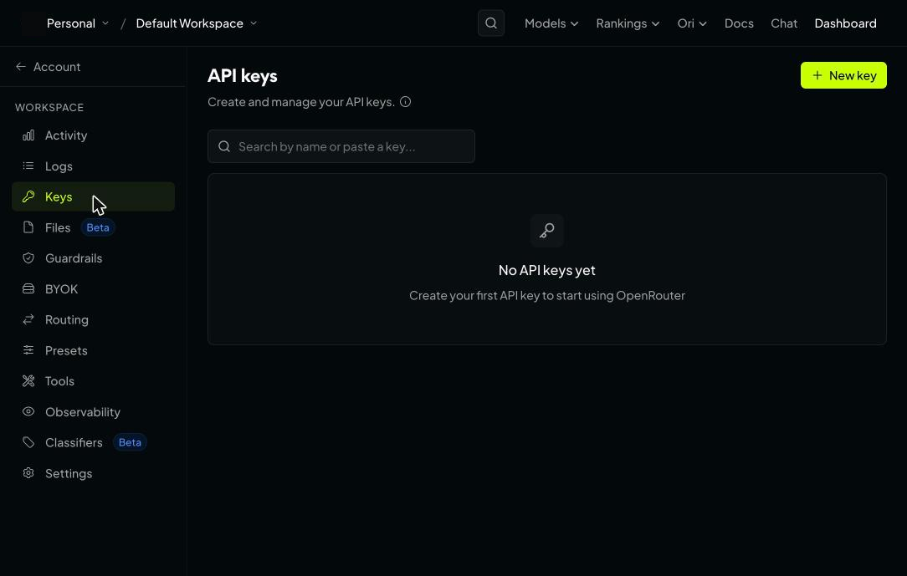
Extra: [06a create-key dialog](06a-keys-create-dialog.png)

**URL / purpose:** Workspace → **Keys** — create and manage inference API keys scoped to a workspace. (A separate account-level **Management keys** page holds admin keys for the provisioning API.)

**Layout:** Title "API keys — Create and manage your API keys" (ⓘ) · **+ New key** · search "Search by name or paste a key…" (paste a full key to find which one it is) · key list.

**Empty state:** key icon, "No API keys yet — Create your first API key to start using OpenRouter".

**Create dialog (closed without creating):**

| Field                          | Options / rule                                                                                                                                               |
| ------------------------------ | ------------------------------------------------------------------------------------------------------------------------------------------------------------ |
| Name *                         | free text, e.g. "Chatbot Key"                                                                                                                                |
| Expiration *                   | 1 hour · 1 day · 7 days · 30 days · 90 days · 180 days · 1 year · No expiration. The account's _Maximum API key lifetime_ policy can cap this (see Privacy). |
| **Key limit → Credit limit *** | $50 · $250 · $1,000 · Custom amount · No limit (spend cap in USD)                                                                                            |
| Reset limit every…             | Disabled ("N/A") until a credit limit is set. Then the cap resets on an interval.                                                                            |
| Create                         | Primary button                                                                                                                                               |

**Main action (not performed):** Create generates the key and shows the full secret once (format `sk-or-…`) for copying. After that the list shows a masked key plus name, limit/usage, expiry, and per-key actions (edit limit, disable, delete). Per-key spend also feeds "Top API Keys" and the API Key filter/dimension in Activity and Logs.

---

## 7. Settings (BYOK, privacy/data policy, provider preferences, organization)

Settings are split between **account level** (Privacy, Security, Preferences, Management keys, Notifications) and **workspace level** (BYOK, Routing, Guardrails, Presets, Tools, Observability, Settings).

### 7a. BYOK — Workspace → BYOK

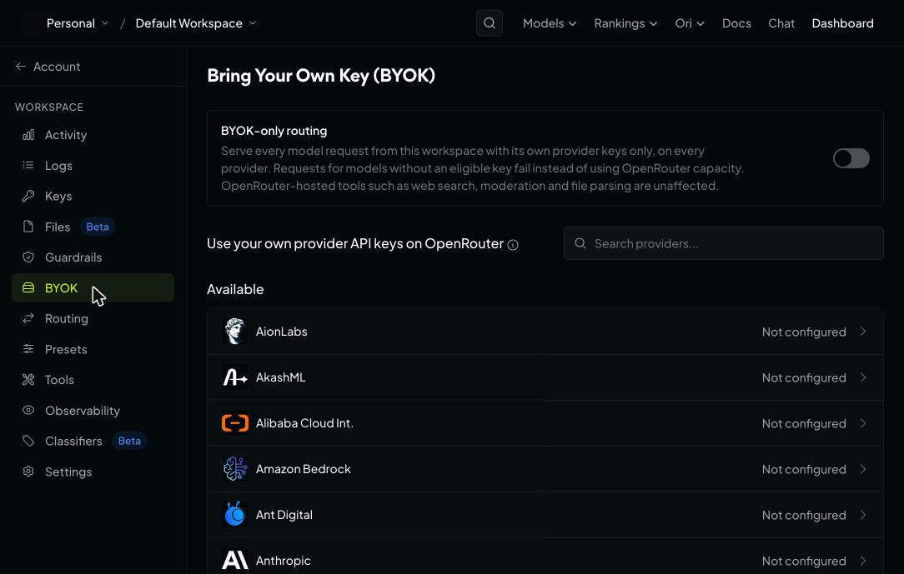

- **BYOK-only routing** toggle: serve every request in the workspace with the workspace's own provider keys only. Models without an eligible key fail instead of falling back to OpenRouter capacity. Hosted tools such as web search, moderation and file parsing are unaffected.
- "Use your own provider API keys" with provider search. Lists ~77 providers ("Not configured" ›). Expanding a provider shows "View supported models", Save, and **Provider Keys** in two draggable, ordered sections:
  - **Prioritized** (tried in order, before OpenRouter endpoints).
  - **Fallback** (tried only after OpenRouter endpoints).
- "Key Priority and Fallback" explainer: your keys are used first. By default OpenRouter falls back to shared endpoints on rate limits or failures. "Always use this key" stops fallback. To never use shared endpoints, set it _and_ pin that provider as the only one.

### 7b. Provider preferences / routing — Workspace → Routing

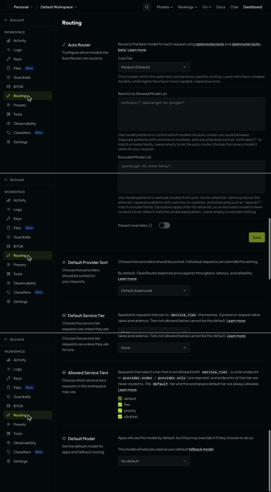

- **Auto Router** (`openrouter/auto`, `openrouter/auto-beta`): Cost Tier (Low / Medium (Default) / High / Extra High / Max), Allowed model list and Excluded model list (wildcard patterns like `anthropic/*`; exclusions apply after the allow list), **Prevent overrides** toggle, Save.
- **Default Provider Sort:** Default (balanced price vs throughput/latency/reliability) · Price (cheapest first) · Throughput (highest first) · Latency (lowest first) · Exacto (tool-call quality first). Individual requests can override it.
- **Default Service Tier:** None / tier, applied when a request sets no `service_tier`.
- **Allowed Service Tiers:** default · flex · priority · ultrafast checkboxes. Disallowed tiers are rejected and never routed to.
- **Default Model:** used by apps by default and as the fallback model.

### 7c. Privacy / data policy — Account → Privacy

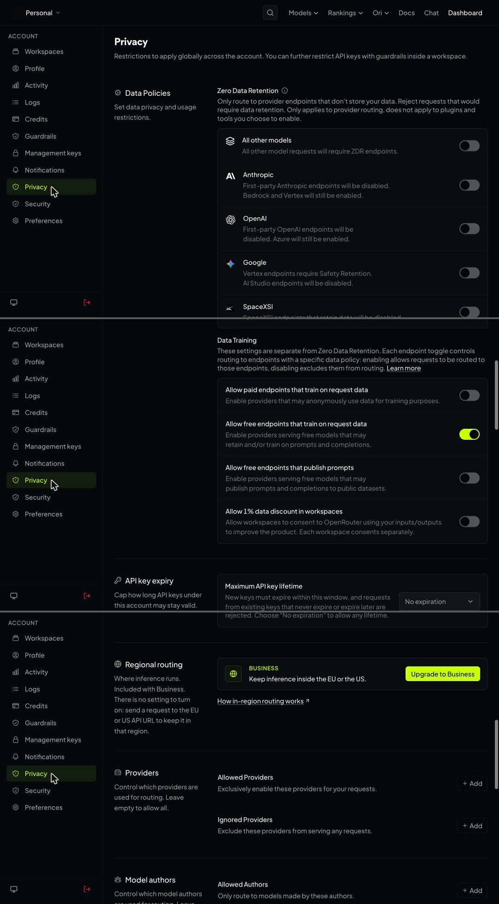

- **Zero Data Retention** toggles: All other models · Anthropic (first-party off; Bedrock/Vertex still on) · OpenAI (first-party off; Azure on) · Google (Vertex requires Safety Retention; AI Studio off) · other per-vendor rows. Applies to provider routing, not to plugins or tools.
- **Data Training** toggles: Allow paid endpoints that train on request data (off) · Allow free endpoints that train on request data (**on** by default) · Allow free endpoints that publish prompts (off) · Allow 1% data discount in workspaces (each workspace consents separately).
- **API key expiry:** Maximum API key lifetime (default No expiration). Existing keys that exceed it get rejected.
- **Regional routing:** Business-plan feature. Choose the EU or US API base URL; no toggle. Upsell "Upgrade to Business".
- **Providers:** Allowed providers / Ignored providers (+ Add). **Model authors:** Allowed authors…
- **Provisional providers:** "Allow provisional providers" (providers not yet through the security review).
- **Eligibility Preview:** "705 available · 3 unavailable" under the current settings, with a model list.
- **Model catalog:** "Filter the models page to models you can use".

### 7d. Organization / workspaces

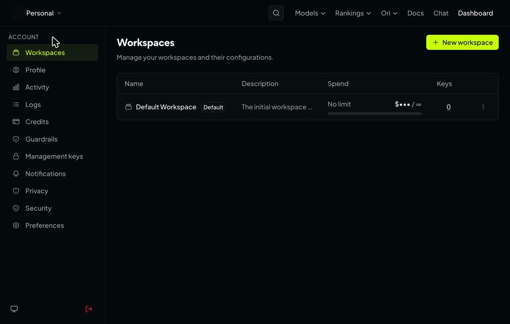 · 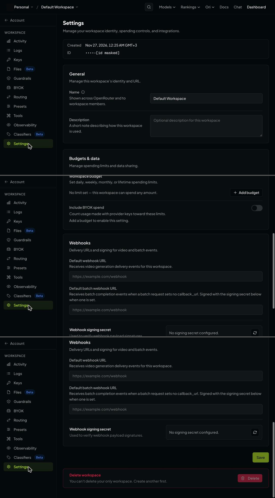

- **Account switcher** ("Personal" ▾): accounts/orgs, quick links (Workspaces, Profile, Activity, Logs, Recent sessions, Credits, Preferences), Language (Beta), Theme, Sign out. The onboarding wizard offers Individual vs **Organization** ("Collaborate with your team and manage usage centrally"). Credits can be moved from personal to an org once 2FA is on.
- **Workspaces** (`/workspaces`): table Name · Description · Spend (limit + used/limit bar, "No limit", "$x / ∞") · Keys (count) · ⋮ actions. Has a **+ New workspace** button.
- **Workspace Settings:**
  - Created timestamp and ID.
  - General: Name, Description.
  - **Budgets & data:** Workspace budget (daily/weekly/monthly/lifetime; "+ Add budget"; "No limit set — this workspace can spend any amount") and **Include BYOK spend** toggle.
  - **Webhooks:** default webhook URL (video generation delivery), default batch webhook URL (when a batch request has no `callback_url`), webhook signing secret (generate/rotate).
  - Save. Danger zone **Delete workspace** (disabled for the only workspace).
- Other workspace pages seen in nav, not opened: Guardrails, Presets (saved model+params configs, referenced in Chat), Tools, Observability, Classifiers (Beta), Files (Beta).

---

## 8. How a request is charged

No request existed in this account, so this section combines what the UI exposes with OpenRouter's public docs: Usage Accounting docs and the Pricing page FAQ.

**Where cost shows up in the UI**

- **Logs row:** Cost (USD), Input tokens, Output tokens, Usage Type (credits vs BYOK), BYOK Usage, Cache Usage, Provider that served it, Speed (tok/s), Routing Overhead, Time to First Token, Finish Reason, API Key.
- **Upstream Requests tab:** each provider attempt, including failed fallbacks.
- **Activity:** spend split _BYOK vs OpenRouter Spend_. Tokens split _Prompt / Completion / Reasoning_ and _Cached vs Uncached_. A "Blended $/1M" KPI.
- **Chat:** "Show metrics inline" shows per-message usage.

**Cost formula (as documented)**

1. Tokens are counted with the **model's native tokenizer**: prompt (input), completion (output), reasoning (billed as output), cached-read and cache-write tokens. Some models bill other units (characters for TTS, per image/video, etc.).
2. Each count is multiplied by the **serving provider's posted per-1M rate** for that endpoint, as on the model page's provider table: Input /M, Output /M, Cache read /M, Cache write (5m/1h) /M. Regional endpoints have their own (higher) rates.
3. **No markup per request.** Inference is billed at the provider's list price. OpenRouter's platform fee is taken **when you buy credits**: 5.5% on Standard, 8% on Business, negotiated on Enterprise. Free models are $0.
4. The cost is deducted from the prepaid credit balance.
5. **Failed / fallback attempts:** an attempt that errors is not charged for model tokens. With fallback you pay only for the run that answers. With "Zero Completion Insurance", an empty response with no finish reason isn't charged. Auxiliary services that already ran (web search, file parsing) may still bill. `openrouter/auto` adds no fee.
6. **Streaming** costs the same as non-streaming.
7. **BYOK:** the provider bills you directly. Standard/Business include $25,000/month of list-price BYOK inference with no fee. Above that, OpenRouter charges 5% of what the request would cost at list price, deducted from credits.

**What the API returns per request** (the same record behind the log detail): every response includes a `usage` object:

```json
"usage": {
  "prompt_tokens": 194, "completion_tokens": 2, "total_tokens": 196,
  "prompt_tokens_details": { "cached_tokens": 0, "cache_write_tokens": 100, "audio_tokens": 0 },
  "completion_tokens_details": { "reasoning_tokens": 0 },
  "cost": 0.95,                       // total charged to the account
  "is_byok": false,
  "cost_details": {
    "upstream_inference_cost": 19,    // what the provider charged
    "upstream_inference_prompt_cost": ..., "upstream_inference_completions_cost": ...
  }
}
```

(The Responses API uses `input_tokens` / `output_tokens` and `upstream_inference_input_cost` / `_output_cost`.) This arrives in the final streaming event or the non-streaming response; no extra flag is needed.

**Effective vs listed price:** The model page shows both. The weighted-average effective input price ($0.55/M) is far below list ($2/M) because of cache-hit rates (56–92% per provider). A gateway should store per-request cached tokens so it can show this.

---

## Features a gateway needs to copy

**Catalog & discovery**

- [ ] Model registry: slug `author/model`, variants (`:free`, batch), aliases ("Latest"), modalities in/out, context, max output, release date, deprecation flag.
- [ ] Per-provider endpoint records: price per 1M input/output/cache-read/cache-write (5m/1h), non-token units (per character, image, video), regional (EU/US) endpoints with their own pricing, quantization/precision, supported parameters, data policy (training, retention, ZDR), moderation, user-ID requirement, BYOK support, stream cancellation.
- [ ] Catalog search, multi-facet filters (modality, price ranges, context, params, ZDR, region, provider, author, throughput, tool-call success, age), many sort keys, list/table views, column chooser, pinning, compare.
- [ ] Live telemetry per endpoint: latency/TTFT/E2E/throughput percentiles (P50–P99), tool-call and structured-output error rates, cache-hit rate, uptime vs availability, 3-day and 24-hour views, "with vs without routing" availability.
- [ ] Price history (listed vs effective) and token-share per provider. Weekly token volume per model and app/category rankings.
- [ ] Model page with copyable API snippet, LLMs.txt, FAQ, and a "Try in chat" deep link.

**Routing**

- [ ] Modes: balanced (default), fastest (nitro), cheapest (floor), batch. Sort by price/throughput/latency/tool-call quality. Per-request override vs workspace default with "prevent overrides".
- [ ] Automatic fallback to the next healthy provider. Upstream-attempt logging. No charge for failed attempts.
- [ ] Auto-router model with cost tier and allow/deny wildcard lists. A default/fallback model.
- [ ] Service tiers (default/flex/priority/ultrafast) with allowed-tier policy.
- [ ] Provider allow/ignore lists, author allow lists, provisional-provider toggle, in-region routing via EU/US base URLs.

**Privacy & governance**

- [ ] Account-wide ZDR (global and per-vendor), data-training toggles (paid/free/publishing), per-workspace data-discount consent, eligibility preview ("N models available under your policy"), filtering the catalog to usable models.
- [ ] Guardrails, maximum API key lifetime, 2FA-gated sensitive actions.

**Accounts, workspaces, keys**

- [ ] Personal vs organization accounts. Multiple workspaces per account, each with keys, budgets (daily/weekly/monthly/lifetime, optional BYOK inclusion), webhooks plus signing secret, presets.
- [ ] Inference API keys: name, required expiry, optional credit limit with reset interval, search by pasted key, show once. Separate management/provisioning keys.
- [ ] BYOK per provider, multiple keys per provider, ordered Prioritized and Fallback groups, "always use this key", workspace-wide BYOK-only mode.

**Billing**

- [ ] Prepaid USD credit balance. Purchase gated on billing address. Card (off-session capable) and crypto. Auto top-up (threshold + amount). Promo codes. Move credits to an org (2FA). Transactions table with receipts. Enterprise invoicing.
- [ ] Platform fee charged at purchase, not per request. Per-request cost = tokens × serving provider's list rate. BYOK fee above an allowance.
- [ ] Return `usage` with token breakdown (cached, cache-write, reasoning, audio), `cost`, `is_byok`, and `upstream_inference_cost` in every response.

**Observability**

- [ ] Dashboard KPIs (spend, requests, tokens, cache-hit rate, blended $/1M) with prior-period deltas. Breakdowns by model, key, app, usage type (BYOK vs credits), token type, cached vs uncached.
- [ ] Pivot "Explore": many metrics (cost, tokens, latency/TTFT/router-latency/generation-time/ITL percentiles, throughput, cache, guardrail, BYOK) × many dimensions (model, variant, key, provider, region, country, streamed, endpoint, finish reason, app, user, custom user ID, session, generation ID). Timezone toggle, rich time ranges, filters.
- [ ] Per-request logs (generations, upstream attempts, sessions, videos, batches) with configurable columns, pagination, export, and a request-detail view.

**Playground**

- [ ] Multi-model rooms with list or side-by-side layout. Per-model params (provider pin + sort, ZDR, streaming, reasoning on/effort, system prompt, full sampling params, file parser), duplicate a model with different params, apply-to-all, presets, tools, attachments, voice input.
- [ ] Inline per-message metrics, export/import/share/markdown, an insufficient-credits path to buy or switch to free models.
